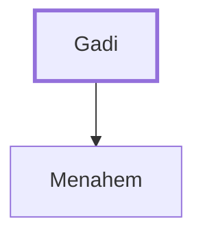

# Gadi

Father of Menahem, king of Israel.

**Original-language names:** גָּדִי (H1424)

## When

- **Placed around:** [[connections/timeline/8th century BC|772 BC]] *(Ussher: the median date of the passages naming them)*

## Family

- **Children:** [[connections/people/Menahem|Menahem]]
- **Tribe or nation:** Israel

**Family group:** [[connections/genealogy/Family of Gadi|Family of Gadi]], generation 1

## Appears in

[[connections/chapters/12-2-kings/2 Kings 15|2 Kings 15 (2)]]

## Appears in the same verse as

[[connections/people/Menahem|Menahem (2)]] · [[connections/places/Samaria|Samaria (2)]] · [[connections/people/Israel|Israel]] · [[connections/people/Jabesh|Jabesh]] · [[connections/people/Judah (Genesis 29.35)|Judah (Genesis 29.35)]] · [[connections/people/Shallum (2 Kings 15.10)|Shallum (2 Kings 15.10)]] · [[connections/people/Uzziah (2 Kings 14.21)|Uzziah (2 Kings 14.21)]] · [[connections/places/Tirzah|Tirzah]]
