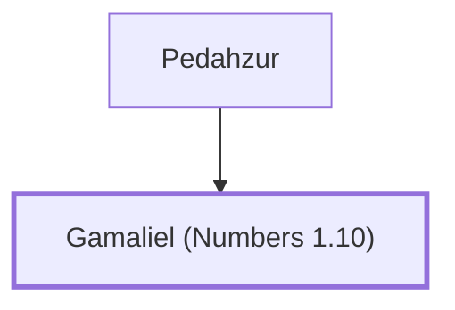

# Gamaliel (Numbers 1.10)

Leader of the tribe of Manasseh during the Exodus.

**Original-language names:** גַּמְלִיאֵל (H1583)

## When

- **Placed around:** [[connections/timeline/15th century BC|1490 BC]] *(Ussher: the median date of the passages naming them)*

## Family

- **Father:** [[connections/people/Pedahzur|Pedahzur]]
- **Tribe or nation:** Tribe of Manasseh

**Family group:** [[connections/genealogy/Family of Pedahzur|Family of Pedahzur]], generation 2

## Appears in

[[connections/chapters/04-numbers/Numbers 1|Numbers 1]] · [[connections/chapters/04-numbers/Numbers 2|Numbers 2]] · [[connections/chapters/04-numbers/Numbers 7|Numbers 7 (2)]] · [[connections/chapters/04-numbers/Numbers 10|Numbers 10]]

## Appears in the same verse as

[[connections/people/Pedahzur|Pedahzur (5)]] · [[connections/people/Manasseh (Genesis 41.51)|Manasseh (Genesis 41.51) (4)]] · [[connections/people/Ammihud (Numbers 1.10)|Ammihud (Numbers 1.10)]] · [[connections/people/Elishama (Numbers 1.10)|Elishama (Numbers 1.10)]] · [[connections/people/Ephraim|Ephraim]] · [[connections/people/Joseph (Genesis 30.24)|Joseph (Genesis 30.24)]]
