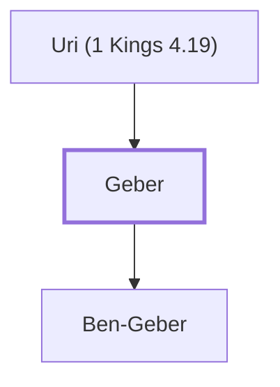

# Geber

Son of Uri; one of Solomon's twelve district governors.

**Original-language names:** גֶּ֫בֶר (H1398)

## When

- **Placed around:** [[connections/timeline/11th century BC|1014 BC]] *(Ussher: the median date of the passages naming them)*

## Family

- **Father:** [[connections/people/Uri (1 Kings 4.19)|Uri (1 Kings 4.19)]]
- **Children:** [[connections/people/Ben-Geber|Ben-Geber]]

**Family group:** [[connections/genealogy/Family of Uri (1 Kings 4.19)|Family of Uri (1 Kings 4.19)]], generation 2

## Appears in

[[connections/chapters/11-1-kings/1 Kings 4|1 Kings 4]]

## Appears in the same verse as

[[connections/people/Og|Og]] · [[connections/people/Sihon|Sihon]] · [[connections/people/Uri (1 Kings 4.19)|Uri (1 Kings 4.19)]] · [[connections/places/Bashan|Bashan]] · [[connections/places/Gilead|Gilead]]
