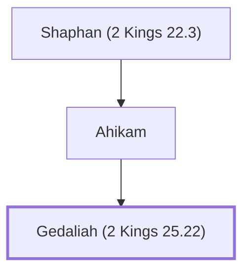

# Gedaliah (2 Kings 25.22)

Appointed governor of Judah by Babylonians; assassinated by Ishmael.

**Original-language names:** גְּדַלְיָ֫הוּ (H1436b) · גְּדַלְיָה (H1436a)

## When

- **Placed around:** [[connections/timeline/6th century BC|588 BC]] *(Ussher: the median date of the passages naming them)*

## Family

- **Father:** [[connections/people/Ahikam|Ahikam]]

**Line of descent** (5 generations, father to son): [[connections/people/Meshullam (2 Kings 22.3)|Meshullam (2 Kings 22.3)]] → [[connections/people/Azaliah|Azaliah]] → [[connections/people/Shaphan (2 Kings 22.3)|Shaphan (2 Kings 22.3)]] → [[connections/people/Ahikam|Ahikam]] → **Gedaliah (2 Kings 25.22)**

**Family group:** [[connections/genealogy/Family of Meshullam (2 Kings 22.3)|Family of Meshullam (2 Kings 22.3)]], generation 5

## Appears in

[[connections/chapters/12-2-kings/2 Kings 25|2 Kings 25 (4)]] · [[connections/chapters/24-jeremiah/Jeremiah 39|Jeremiah 39]] · [[connections/chapters/24-jeremiah/Jeremiah 40|Jeremiah 40 (11)]] · [[connections/chapters/24-jeremiah/Jeremiah 41|Jeremiah 41 (9)]] · [[connections/chapters/24-jeremiah/Jeremiah 43|Jeremiah 43]]

## Appears in the same verse as

[[connections/people/Ahikam|Ahikam (16)]] · [[connections/people/Ishmael (2 Kings 25.23)|Ishmael (2 Kings 25.23) (14)]] · [[connections/people/Nethaniah (2 Kings 25.23)|Nethaniah (2 Kings 25.23) (12)]] · [[connections/places/Mizpah|Mizpah (12)]] · [[connections/places/Babylon|Babylon (9)]] · [[connections/people/Shaphan (2 Kings 22.3)|Shaphan (2 Kings 22.3) (7)]] · [[connections/people/Johanan (2 Kings 25.23)|Johanan (2 Kings 25.23) (6)]] · [[connections/people/Kareah|Kareah (6)]] · [[connections/people/Judah (Genesis 29.35)|Judah (Genesis 29.35) (5)]] · [[connections/places/Chaldea|Chaldea (5)]] · [[connections/people/Jeremiah (2 Chronicles 35.25)|Jeremiah (2 Chronicles 35.25) (3)]] · [[connections/places/Ammon|Ammon (3)]] · [[connections/people/Elishama (2 Kings 25.25)|Elishama (2 Kings 25.25) (2)]] · [[connections/people/Jezaniah|Jezaniah (2)]] · [[connections/people/Nebuzaradan|Nebuzaradan (2)]] · [[connections/people/Seraiah (2 Kings 25.23)|Seraiah (2 Kings 25.23) (2)]] · [[connections/people/Tanhumeth|Tanhumeth (2)]] · [[connections/people/Asa (1 Kings 15.8)|Asa (1 Kings 15.8)]] · [[connections/people/Baalis|Baalis]] · [[connections/people/Baasha|Baasha]] · [[connections/people/Baruch (Jeremiah 32.12)|Baruch (Jeremiah 32.12)]] · [[connections/people/Ephai|Ephai]] · [[connections/people/Israel|Israel]] · [[connections/people/Jonathan (Jeremiah 40.8)|Jonathan (Jeremiah 40.8)]] · [[connections/people/Nebuchadnezzar|Nebuchadnezzar]] · [[connections/people/Neriah|Neriah]] · [[connections/places/Edom|Edom]] · [[connections/places/Gibeon|Gibeon]] · [[connections/places/Moab|Moab]]
