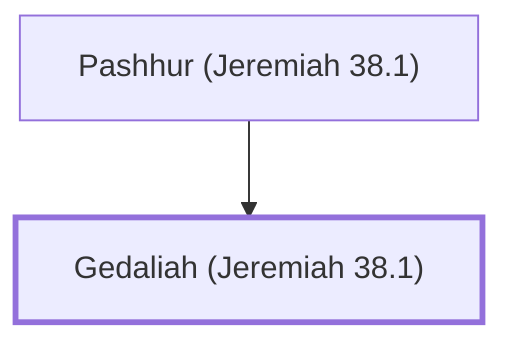

# Gedaliah (Jeremiah 38.1)

Son of Pashhur; an official during Zedekiah's reign.

**Original-language names:** גְּדַלְיָ֫הוּ (H1436b)

## When

- **Placed around:** [[connections/timeline/6th century BC|598 BC]] *(Ussher: the median date of the passages naming them)*

## Family

- **Father:** [[connections/people/Pashhur (Jeremiah 38.1)|Pashhur (Jeremiah 38.1)]]

**Family group:** [[connections/genealogy/Family of Pashhur (Jeremiah 38.1)|Family of Pashhur (Jeremiah 38.1)]], generation 2

## Appears in

[[connections/chapters/24-jeremiah/Jeremiah 38|Jeremiah 38]]

## Appears in the same verse as

[[connections/people/Jehucal|Jehucal]] · [[connections/people/Jeremiah (2 Chronicles 35.25)|Jeremiah (2 Chronicles 35.25)]] · [[connections/people/Malchiah|Malchiah]] · [[connections/people/Mattan (Jeremiah 38.1)|Mattan (Jeremiah 38.1)]] · [[connections/people/Pashhur (Jeremiah 21.1)|Pashhur (Jeremiah 21.1)]] · [[connections/people/Pashhur (Jeremiah 38.1)|Pashhur (Jeremiah 38.1)]] · [[connections/people/Shelemiah (Jeremiah 37.3)|Shelemiah (Jeremiah 37.3)]] · [[connections/people/Shephatiah (Jeremiah 38.1)|Shephatiah (Jeremiah 38.1)]]
