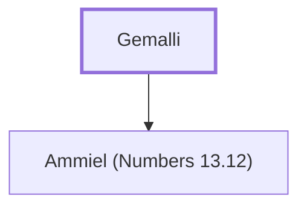

# Gemalli

Father of Ammiel, the spy from the tribe of Dan.

**Original-language names:** גְּמַלִּי (H1582)

## When

- **Placed around:** [[connections/timeline/15th century BC|1490 BC]] *(Ussher: the median date of the passages naming them)*

## Family

- **Children:** [[connections/people/Ammiel (Numbers 13.12)|Ammiel (Numbers 13.12)]]

**Family group:** [[connections/genealogy/Family of Gemalli|Family of Gemalli]], generation 1

## Appears in

[[connections/chapters/04-numbers/Numbers 13|Numbers 13]]

## Appears in the same verse as

[[connections/people/Ammiel (Numbers 13.12)|Ammiel (Numbers 13.12)]] · [[connections/places/Dan|Dan]]
