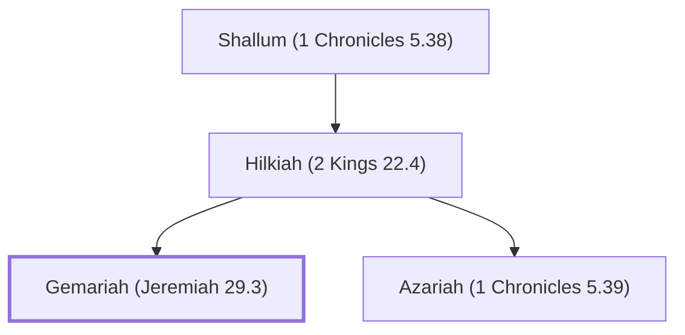

# Gemariah (Jeremiah 29.3)

Son of Hilkiah; messenger sent by Zedekiah to Nebuchadnezzar.

**Original-language names:** גְּמַרְיָ֫הוּ (H1587)

## When

- **Placed around:** [[connections/timeline/6th century BC|599 BC]] *(Ussher: the median date of the passages naming them)*

## Family

- **Father:** [[connections/people/Hilkiah (2 Kings 22.4)|Hilkiah (2 Kings 22.4)]]
- **Brothers and sisters:** [[connections/people/Azariah (1 Chronicles 5.39)|Azariah (1 Chronicles 5.39)]]
- **Tribe or nation:** Tribe of Levi

**Line of descent** (47 generations, father to son): [[connections/people/Adam|Adam]] → [[connections/people/Seth|Seth]] → [[connections/people/Enosh|Enosh]] → [[connections/people/Kenan|Kenan]] → [[connections/people/Mahalalel (Genesis 5.12)|Mahalalel (Genesis 5.12)]] → [[connections/people/Jared|Jared]] → [[connections/people/Enoch (Genesis 5.18)|Enoch (Genesis 5.18)]] → [[connections/people/Methuselah|Methuselah]] → [[connections/people/Lamech (Genesis 5.25)|Lamech (Genesis 5.25)]] → [[connections/people/Noah (Genesis 5.29)|Noah (Genesis 5.29)]] → [[connections/people/Shem|Shem]] → [[connections/people/Arpachshad|Arpachshad]] → [[connections/people/Cainan|Cainan]] → [[connections/people/Shelah (Genesis 10.24)|Shelah (Genesis 10.24)]] → [[connections/people/Eber (Genesis 10.21)|Eber (Genesis 10.21)]] → [[connections/people/Peleg|Peleg]] → [[connections/people/Reu|Reu]] → [[connections/people/Serug|Serug]] → [[connections/people/Nahor (Genesis 11.22)|Nahor (Genesis 11.22)]] → [[connections/people/Terah|Terah]] → [[connections/people/Abraham|Abraham]] → [[connections/people/Isaac|Isaac]] → [[connections/people/Israel|Israel]] → [[connections/people/Levi (Genesis 29.34)|Levi (Genesis 29.34)]] → [[connections/people/Kohath|Kohath]] → [[connections/people/Amram (Exodus 6.18)|Amram (Exodus 6.18)]] → [[connections/people/Aaron|Aaron]] → [[connections/people/Eleazar (Exodus 6.23)|Eleazar (Exodus 6.23)]] → [[connections/people/Phinehas (Exodus 6.25)|Phinehas (Exodus 6.25)]] → [[connections/people/Abishua (1 Chronicles 5.30)|Abishua (1 Chronicles 5.30)]] → [[connections/people/Bukki (1 Chronicles 5.31)|Bukki (1 Chronicles 5.31)]] → [[connections/people/Uzzi (1 Chronicles 5.31)|Uzzi (1 Chronicles 5.31)]] → [[connections/people/Zerahiah (1 Chronicles 5.32)|Zerahiah (1 Chronicles 5.32)]] → [[connections/people/Meraioth|Meraioth]] → [[connections/people/Amariah (1 Chronicles 5.33)|Amariah (1 Chronicles 5.33)]] → [[connections/people/Ahitub (2 Samuel 8.17)|Ahitub (2 Samuel 8.17)]] → [[connections/people/Zadok (2 Samuel 8.17)|Zadok (2 Samuel 8.17)]] → [[connections/people/Ahimaaz (2 Samuel 15.27)|Ahimaaz (2 Samuel 15.27)]] → [[connections/people/Azariah (1 Kings 4.2)|Azariah (1 Kings 4.2)]] → [[connections/people/Johanan (1 Chronicles 5.35)|Johanan (1 Chronicles 5.35)]] → [[connections/people/Azariah (1 Chronicles 5.36)|Azariah (1 Chronicles 5.36)]] → [[connections/people/Amariah (1 Chronicles 5.37)|Amariah (1 Chronicles 5.37)]] → [[connections/people/Ahitub (1 Chronicles 5.37)|Ahitub (1 Chronicles 5.37)]] → [[connections/people/Zadok (1 Chronicles 5.38)|Zadok (1 Chronicles 5.38)]] → [[connections/people/Shallum (1 Chronicles 5.38)|Shallum (1 Chronicles 5.38)]] → [[connections/people/Hilkiah (2 Kings 22.4)|Hilkiah (2 Kings 22.4)]] → **Gemariah (Jeremiah 29.3)**

**Family group:** [[connections/genealogy/Family of Adam|Family of Adam]], generation 47

## Appears in

[[connections/chapters/24-jeremiah/Jeremiah 29|Jeremiah 29]]

## Appears in the same verse as

[[connections/people/Elasah (Jeremiah 29.3)|Elasah (Jeremiah 29.3)]] · [[connections/people/Hilkiah (2 Kings 22.4)|Hilkiah (2 Kings 22.4)]] · [[connections/people/Judah (Genesis 29.35)|Judah (Genesis 29.35)]] · [[connections/people/Nebuchadnezzar|Nebuchadnezzar]] · [[connections/people/Shaphan (2 Kings 22.3)|Shaphan (2 Kings 22.3)]] · [[connections/people/Zedekiah (2 Kings 24.17)|Zedekiah (2 Kings 24.17)]] · [[connections/places/Babylon|Babylon]]
