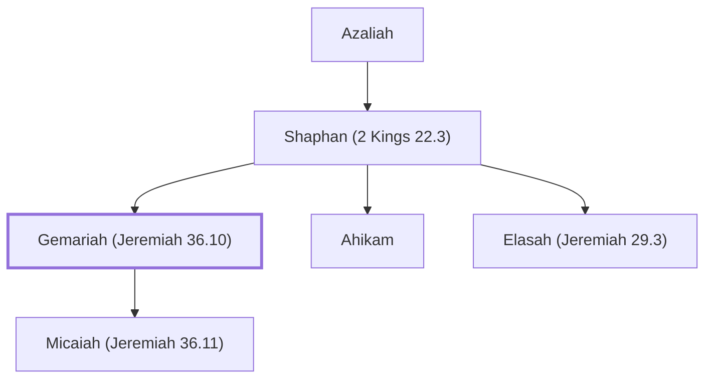

# Gemariah (Jeremiah 36.10)

Son of Shaphan; official during Jehoiakim's reign; opposed burning scroll.

**Original-language names:** גְּמַרְיָ֫הוּ (H1587)

## When

- **Placed around:** [[connections/timeline/7th century BC|606 BC]] *(Ussher: the median date of the passages naming them)*

## Family

- **Father:** [[connections/people/Shaphan (2 Kings 22.3)|Shaphan (2 Kings 22.3)]]
- **Brothers and sisters:** [[connections/people/Ahikam|Ahikam]], [[connections/people/Elasah (Jeremiah 29.3)|Elasah (Jeremiah 29.3)]]
- **Children:** [[connections/people/Micaiah (Jeremiah 36.11)|Micaiah (Jeremiah 36.11)]]

**Line of descent** (4 generations, father to son): [[connections/people/Meshullam (2 Kings 22.3)|Meshullam (2 Kings 22.3)]] → [[connections/people/Azaliah|Azaliah]] → [[connections/people/Shaphan (2 Kings 22.3)|Shaphan (2 Kings 22.3)]] → **Gemariah (Jeremiah 36.10)**

**Family group:** [[connections/genealogy/Family of Meshullam (2 Kings 22.3)|Family of Meshullam (2 Kings 22.3)]], generation 4

## Appears in

[[connections/chapters/24-jeremiah/Jeremiah 36|Jeremiah 36 (4)]]

## Appears in the same verse as

[[connections/people/Shaphan (2 Kings 22.3)|Shaphan (2 Kings 22.3) (3)]] · [[connections/people/Delaiah (Jeremiah 36.12)|Delaiah (Jeremiah 36.12) (2)]] · [[connections/people/Elnathan (Jeremiah 26.22)|Elnathan (Jeremiah 26.22) (2)]] · [[connections/people/Achbor (2 Kings 22.12)|Achbor (2 Kings 22.12)]] · [[connections/people/Baruch (Jeremiah 32.12)|Baruch (Jeremiah 32.12)]] · [[connections/people/Elishama (Jeremiah 36.12)|Elishama (Jeremiah 36.12)]] · [[connections/people/Hananiah (Jeremiah 36.12)|Hananiah (Jeremiah 36.12)]] · [[connections/people/Jeremiah (2 Chronicles 35.25)|Jeremiah (2 Chronicles 35.25)]] · [[connections/people/Micaiah (Jeremiah 36.11)|Micaiah (Jeremiah 36.11)]] · [[connections/people/Shemaiah (Jeremiah 36.12)|Shemaiah (Jeremiah 36.12)]] · [[connections/people/Zedekiah (Jeremiah 36.12)|Zedekiah (Jeremiah 36.12)]] · [[connections/places/New Gate|New Gate]]
