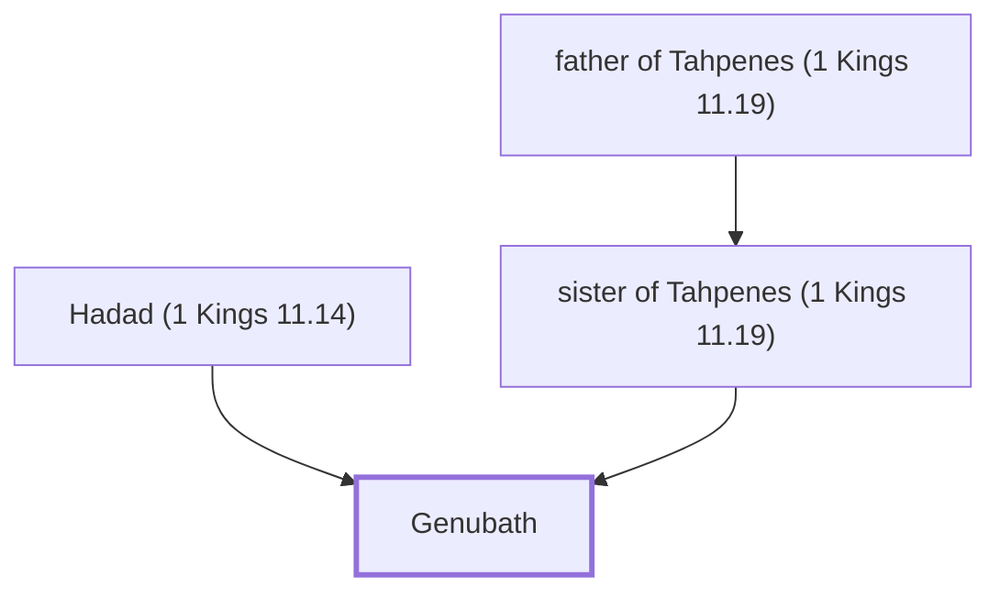

# Genubath

Son of Hadad the Edomite; raised in Pharaoh's palace.

**Original-language names:** גְּנֻבַת (H1592)

## When

- **Placed around:** [[connections/timeline/10th century BC|984 BC]] *(Ussher: the median date of the passages naming them)*

## Family

- **Father:** [[connections/people/Hadad (1 Kings 11.14)|Hadad (1 Kings 11.14)]]
- **Mother:** [[connections/people/sister of Tahpenes (1 Kings 11.19)|sister of Tahpenes (1 Kings 11.19)]]

**Family group:** [[connections/genealogy/Family of father of Tahpenes (1 Kings 11.19)|Family of father of Tahpenes (1 Kings 11.19)]], generation 3

## Appears in

[[connections/chapters/11-1-kings/1 Kings 11|1 Kings 11]]

## Appears in the same verse as

[[connections/people/Pharaoh (1 Kings 3.1)|Pharaoh (1 Kings 3.1)]] · [[connections/people/Tahpenes|Tahpenes]]
