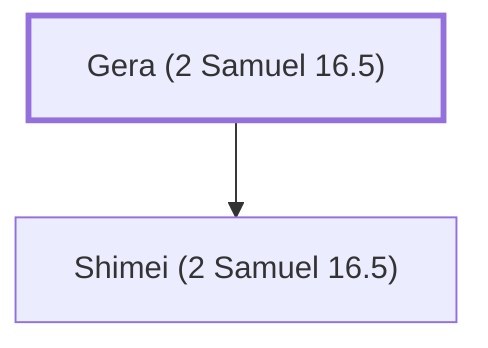

# Gera (2 Samuel 16.5)

Benjamite; cursed David during Absalom's rebellion; later sought forgiveness.

**Original-language names:** גֵּרָא (H1617)

## When

- **Placed around:** [[connections/timeline/11th century BC|1023 BC]] *(Ussher: the median date of the passages naming them)*

## Family

- **Children:** [[connections/people/Shimei (2 Samuel 16.5)|Shimei (2 Samuel 16.5)]]

**Family group:** [[connections/genealogy/Family of Gera (2 Samuel 16.5)|Family of Gera (2 Samuel 16.5)]], generation 1

## Appears in

[[connections/chapters/10-2-samuel/2 Samuel 16|2 Samuel 16]] · [[connections/chapters/10-2-samuel/2 Samuel 19|2 Samuel 19 (2)]] · [[connections/chapters/11-1-kings/1 Kings 2|1 Kings 2]]

## Appears in the same verse as

[[connections/people/Shimei (2 Samuel 16.5)|Shimei (2 Samuel 16.5) (4)]] · [[connections/places/Bahurim|Bahurim (3)]] · [[connections/people/David|David (2)]] · [[connections/places/Jordan|Jordan (2)]] · [[connections/people/Judah (Genesis 29.35)|Judah (Genesis 29.35)]] · [[connections/people/Saul|Saul]] · [[connections/places/Mahanaim|Mahanaim]]
