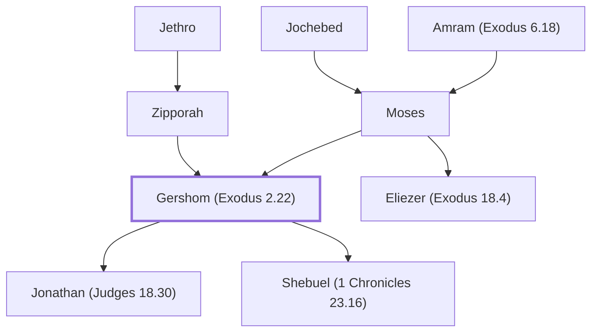

# Gershom (Exodus 2.22)

Son of Moses; father of Jonathan, a renegade priest.

**Original-language names:** גֵּרְשֹׁם (H1647)

## When

- **Placed around:** [[connections/timeline/11th century BC|1015 BC]] *(Ussher: the median date of the passages naming them)*

## Family

- **Father:** [[connections/people/Moses|Moses]]
- **Mother:** [[connections/people/Zipporah|Zipporah]]
- **Brothers and sisters:** [[connections/people/Eliezer (Exodus 18.4)|Eliezer (Exodus 18.4)]]
- **Children:** [[connections/people/Jonathan (Judges 18.30)|Jonathan (Judges 18.30) (uncertain)]], [[connections/people/Shebuel (1 Chronicles 23.16)|Shebuel (1 Chronicles 23.16)]]
- **Tribe or nation:** Tribe of Levi

**Line of descent** (28 generations, father to son): [[connections/people/Adam|Adam]] → [[connections/people/Seth|Seth]] → [[connections/people/Enosh|Enosh]] → [[connections/people/Kenan|Kenan]] → [[connections/people/Mahalalel (Genesis 5.12)|Mahalalel (Genesis 5.12)]] → [[connections/people/Jared|Jared]] → [[connections/people/Enoch (Genesis 5.18)|Enoch (Genesis 5.18)]] → [[connections/people/Methuselah|Methuselah]] → [[connections/people/Lamech (Genesis 5.25)|Lamech (Genesis 5.25)]] → [[connections/people/Noah (Genesis 5.29)|Noah (Genesis 5.29)]] → [[connections/people/Shem|Shem]] → [[connections/people/Arpachshad|Arpachshad]] → [[connections/people/Cainan|Cainan]] → [[connections/people/Shelah (Genesis 10.24)|Shelah (Genesis 10.24)]] → [[connections/people/Eber (Genesis 10.21)|Eber (Genesis 10.21)]] → [[connections/people/Peleg|Peleg]] → [[connections/people/Reu|Reu]] → [[connections/people/Serug|Serug]] → [[connections/people/Nahor (Genesis 11.22)|Nahor (Genesis 11.22)]] → [[connections/people/Terah|Terah]] → [[connections/people/Abraham|Abraham]] → [[connections/people/Isaac|Isaac]] → [[connections/people/Israel|Israel]] → [[connections/people/Levi (Genesis 29.34)|Levi (Genesis 29.34)]] → [[connections/people/Kohath|Kohath]] → [[connections/people/Amram (Exodus 6.18)|Amram (Exodus 6.18)]] → [[connections/people/Moses|Moses]] → **Gershom (Exodus 2.22)**

**Family group:** [[connections/genealogy/Family of Adam|Family of Adam]], generation 28

## Appears in

[[connections/chapters/02-exodus/Exodus 2|Exodus 2]] · [[connections/chapters/02-exodus/Exodus 18|Exodus 18]] · [[connections/chapters/07-judges/Judges 18|Judges 18]] · [[connections/chapters/13-1-chronicles/1 Chronicles 23|1 Chronicles 23 (2)]] · [[connections/chapters/13-1-chronicles/1 Chronicles 26|1 Chronicles 26]]

## Appears in the same verse as

[[connections/people/Moses|Moses (3)]] · [[connections/people/Shebuel (1 Chronicles 23.16)|Shebuel (1 Chronicles 23.16) (2)]] · [[connections/people/Eliezer (Exodus 18.4)|Eliezer (Exodus 18.4)]] · [[connections/people/Jonathan (Judges 18.30)|Jonathan (Judges 18.30)]] · [[connections/places/Dan|Dan]]
