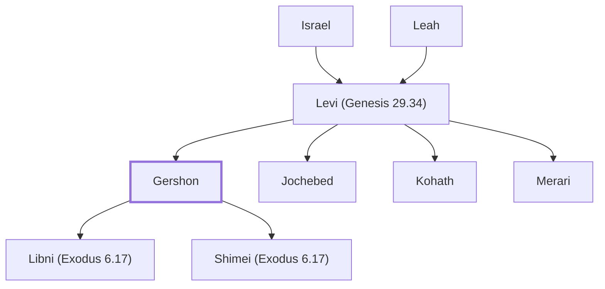

# Gershon

Firstborn son of Levi; head of the Gershonite Levites.

**Original-language names:** גֵּרְשׁוֹן (H1648) · גֵּרְשֹׁם (H1647)

## When

- **Placed around:** [[connections/timeline/15th century BC|1490 BC]] *(Ussher: the median date of the passages naming them)*

## Family

- **Father:** [[connections/people/Levi (Genesis 29.34)|Levi (Genesis 29.34)]]
- **Brothers and sisters:** [[connections/people/Jochebed|Jochebed]], [[connections/people/Kohath|Kohath]], [[connections/people/Merari|Merari]]
- **Children:** [[connections/people/Libni (Exodus 6.17)|Libni (Exodus 6.17)]], [[connections/people/Shimei (Exodus 6.17)|Shimei (Exodus 6.17)]]
- **Tribe or nation:** Tribe of Levi

**Line of descent** (25 generations, father to son): [[connections/people/Adam|Adam]] → [[connections/people/Seth|Seth]] → [[connections/people/Enosh|Enosh]] → [[connections/people/Kenan|Kenan]] → [[connections/people/Mahalalel (Genesis 5.12)|Mahalalel (Genesis 5.12)]] → [[connections/people/Jared|Jared]] → [[connections/people/Enoch (Genesis 5.18)|Enoch (Genesis 5.18)]] → [[connections/people/Methuselah|Methuselah]] → [[connections/people/Lamech (Genesis 5.25)|Lamech (Genesis 5.25)]] → [[connections/people/Noah (Genesis 5.29)|Noah (Genesis 5.29)]] → [[connections/people/Shem|Shem]] → [[connections/people/Arpachshad|Arpachshad]] → [[connections/people/Cainan|Cainan]] → [[connections/people/Shelah (Genesis 10.24)|Shelah (Genesis 10.24)]] → [[connections/people/Eber (Genesis 10.21)|Eber (Genesis 10.21)]] → [[connections/people/Peleg|Peleg]] → [[connections/people/Reu|Reu]] → [[connections/people/Serug|Serug]] → [[connections/people/Nahor (Genesis 11.22)|Nahor (Genesis 11.22)]] → [[connections/people/Terah|Terah]] → [[connections/people/Abraham|Abraham]] → [[connections/people/Isaac|Isaac]] → [[connections/people/Israel|Israel]] → [[connections/people/Levi (Genesis 29.34)|Levi (Genesis 29.34)]] → **Gershon**

**Family group:** [[connections/genealogy/Family of Adam|Family of Adam]], generation 25

## Appears in

[[connections/chapters/01-genesis/Genesis 46|Genesis 46]] · [[connections/chapters/02-exodus/Exodus 6|Exodus 6 (2)]] · [[connections/chapters/04-numbers/Numbers 3|Numbers 3 (4)]] · [[connections/chapters/04-numbers/Numbers 4|Numbers 4 (3)]] · [[connections/chapters/04-numbers/Numbers 7|Numbers 7]] · [[connections/chapters/04-numbers/Numbers 10|Numbers 10]] · [[connections/chapters/04-numbers/Numbers 26|Numbers 26]] · [[connections/chapters/06-joshua/Joshua 21|Joshua 21 (2)]] · [[connections/chapters/13-1-chronicles/1 Chronicles 5|1 Chronicles 5]] · [[connections/chapters/13-1-chronicles/1 Chronicles 6|1 Chronicles 6 (6)]] · [[connections/chapters/13-1-chronicles/1 Chronicles 15|1 Chronicles 15]] · [[connections/chapters/13-1-chronicles/1 Chronicles 23|1 Chronicles 23]]

## Appears in the same verse as

[[connections/people/Merari|Merari (8)]] · [[connections/people/Kohath|Kohath (7)]] · [[connections/people/Levi (Genesis 29.34)|Levi (Genesis 29.34) (7)]] · [[connections/people/Libni (Exodus 6.17)|Libni (Exodus 6.17) (4)]] · [[connections/people/Manasseh (Genesis 41.51)|Manasseh (Genesis 41.51) (4)]] · [[connections/places/Bashan|Bashan (4)]] · [[connections/people/Shimei (Exodus 6.17)|Shimei (Exodus 6.17) (3)]] · [[connections/people/Asher|Asher (2)]] · [[connections/people/Issachar (Genesis 30.18)|Issachar (Genesis 30.18) (2)]] · [[connections/people/Jehiel (1 Chronicles 6.5)|Jehiel (1 Chronicles 6.5) (2)]] · [[connections/people/Naphtali|Naphtali (2)]] · [[connections/places/Ashtaroth|Ashtaroth (2)]] · [[connections/places/Golan|Golan (2)]] · [[connections/people/Aaron|Aaron]] · [[connections/people/David|David]] · [[connections/people/Joel (1 Chronicles 15.7)|Joel (1 Chronicles 15.7)]] · [[connections/people/Moses|Moses]] · [[connections/people/Zimmah (1 Chronicles 6.5)|Zimmah (1 Chronicles 6.5)]]
