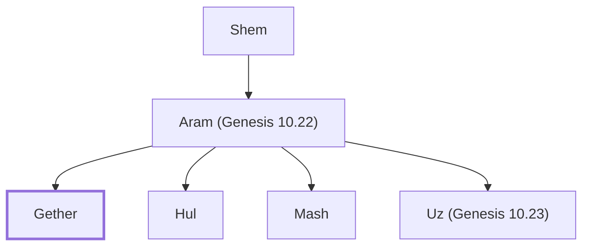

# Gether

Son of Aram; grandson of Shem; part of Table of Nations.

**Original-language names:** גֶּ֫תֶר (H1666)

## When

- **Placed around:** [[connections/timeline/24th century BC|2304 BC]] *(Ussher: the median date of the passages naming them)*

## Family

- **Father:** [[connections/people/Aram (Genesis 10.22)|Aram (Genesis 10.22)]]
- **Brothers and sisters:** [[connections/people/Hul|Hul]], [[connections/people/Mash|Mash]], [[connections/people/Uz (Genesis 10.23)|Uz (Genesis 10.23)]]
- **Tribe or nation:** Early Patriarch

**Line of descent** (13 generations, father to son): [[connections/people/Adam|Adam]] → [[connections/people/Seth|Seth]] → [[connections/people/Enosh|Enosh]] → [[connections/people/Kenan|Kenan]] → [[connections/people/Mahalalel (Genesis 5.12)|Mahalalel (Genesis 5.12)]] → [[connections/people/Jared|Jared]] → [[connections/people/Enoch (Genesis 5.18)|Enoch (Genesis 5.18)]] → [[connections/people/Methuselah|Methuselah]] → [[connections/people/Lamech (Genesis 5.25)|Lamech (Genesis 5.25)]] → [[connections/people/Noah (Genesis 5.29)|Noah (Genesis 5.29)]] → [[connections/people/Shem|Shem]] → [[connections/people/Aram (Genesis 10.22)|Aram (Genesis 10.22)]] → **Gether**

**Family group:** [[connections/genealogy/Family of Adam|Family of Adam]], generation 13

## Appears in

[[connections/chapters/01-genesis/Genesis 10|Genesis 10]] · [[connections/chapters/13-1-chronicles/1 Chronicles 1|1 Chronicles 1]]

## Appears in the same verse as

[[connections/people/Aram (Genesis 10.22)|Aram (Genesis 10.22) (2)]] · [[connections/people/Hul|Hul (2)]] · [[connections/people/Mash|Mash (2)]] · [[connections/people/Uz (Genesis 10.23)|Uz (Genesis 10.23) (2)]] · [[connections/people/Arpachshad|Arpachshad]] · [[connections/people/Asshur|Asshur]] · [[connections/people/Elam (Genesis 10.22)|Elam (Genesis 10.22)]] · [[connections/people/Lud|Lud]] · [[connections/people/Shem|Shem]]
