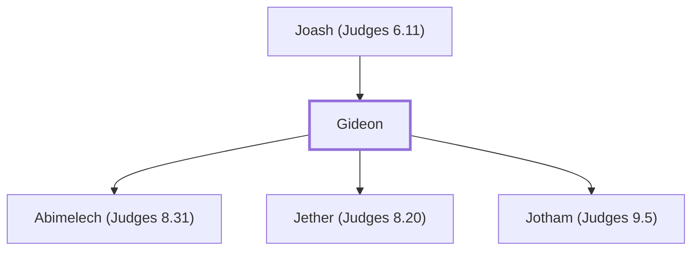

# Gideon

Judge of Israel; defeated Midianites; tested and reassured by God.

**Also called:** Jerubbaal, Jerubbesheth

**Original-language names:** גִּדְעוֹן (H1439) · יְרֻבַּ֫עַל (H3378) · יְרֻבֶּשֶׁת (H3380) · Γεδεών (G1066)

## When

- **Placed around:** [[connections/timeline/13th century BC|1245 BC]] *(Ussher: the median date of the passages naming them)*

## Family

- **Father:** [[connections/people/Joash (Judges 6.11)|Joash (Judges 6.11)]]
- **Children:** [[connections/people/Abimelech (Judges 8.31)|Abimelech (Judges 8.31)]], [[connections/people/Jether (Judges 8.20)|Jether (Judges 8.20)]], [[connections/people/Jotham (Judges 9.5)|Jotham (Judges 9.5)]]

**Family group:** [[connections/genealogy/Family of Joash (Judges 6.11)|Family of Joash (Judges 6.11)]], generation 2

## Events

- [[connections/timeline/13th century BC|1251 BC]] · [[connections/events/Deliverance by Gideon|Deliverance by Gideon]]

## Appears in

[[connections/chapters/07-judges/Judges 6|Judges 6 (11)]] · [[connections/chapters/07-judges/Judges 7|Judges 7 (13)]] · [[connections/chapters/07-judges/Judges 8|Judges 8 (15)]] · [[connections/chapters/07-judges/Judges 9|Judges 9 (8)]] · [[connections/chapters/09-1-samuel/1 Samuel 12|1 Samuel 12]] · [[connections/chapters/10-2-samuel/2 Samuel 11|2 Samuel 11]] · [[connections/chapters/58-hebrews/Hebrews 11|Hebrews 11]]

## Appears in the same verse as

[[connections/places/Midian|Midian (12)]] · [[connections/people/Israel|Israel (9)]] · [[connections/people/Abimelech (Judges 8.31)|Abimelech (Judges 8.31) (6)]] · [[connections/people/Joash (Judges 6.11)|Joash (Judges 6.11) (6)]] · [[connections/places/Ophrah (Joshua 19.19)|Ophrah (Joshua 19.19) (5)]] · [[connections/places/Shechem|Shechem (5)]] · [[connections/places/Jordan|Jordan (3)]] · [[connections/people/Barak|Barak (2)]] · [[connections/people/Jephthah|Jephthah (2)]] · [[connections/people/Jotham (Judges 9.5)|Jotham (Judges 9.5) (2)]] · [[connections/people/Samuel|Samuel (2)]] · [[connections/people/Zalmunna|Zalmunna (2)]] · [[connections/people/Zebah|Zebah (2)]] · [[connections/people/Abiezer (Numbers 26.30)|Abiezer (Numbers 26.30)]] · [[connections/people/David|David]] · [[connections/people/Ebed (Judges 9.26)|Ebed (Judges 9.26)]] · [[connections/people/Ephraim|Ephraim]] · [[connections/people/Gaal|Gaal]] · [[connections/people/Hamor|Hamor]] · [[connections/people/Oreb|Oreb]] · [[connections/people/Samson|Samson]] · [[connections/people/Uriah (2 Samuel 11.3)|Uriah (2 Samuel 11.3)]] · [[connections/people/Zebul|Zebul]] · [[connections/people/Zeeb|Zeeb]] · [[connections/places/Beth-barah|Beth-barah]] · [[connections/places/Egypt|Egypt]] · [[connections/places/Harod|Harod]] · [[connections/places/Heres|Heres]] · [[connections/places/Jogbehah|Jogbehah]] · [[connections/places/Kenath|Kenath]] · [[connections/places/Moreh (Judges 7.1)|Moreh (Judges 7.1)]] · [[connections/places/Thebez|Thebez]]
