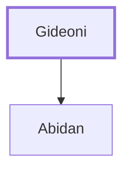

# Gideoni

Leader of the tribe of Benjamin during the Exodus.

**Original-language names:** גִּדְעֹנִי (H1441)

## When

- **Placed around:** [[connections/timeline/15th century BC|1490 BC]] *(Ussher: the median date of the passages naming them)*

## Family

- **Children:** [[connections/people/Abidan|Abidan]]
- **Tribe or nation:** Tribe of Benjamin

**Family group:** [[connections/genealogy/Family of Gideoni|Family of Gideoni]], generation 1

## Appears in

[[connections/chapters/04-numbers/Numbers 1|Numbers 1]] · [[connections/chapters/04-numbers/Numbers 2|Numbers 2]] · [[connections/chapters/04-numbers/Numbers 7|Numbers 7 (2)]] · [[connections/chapters/04-numbers/Numbers 10|Numbers 10]]

## Appears in the same verse as

[[connections/people/Abidan|Abidan (5)]] · [[connections/people/Benjamin (Genesis 35.18)|Benjamin (Genesis 35.18) (4)]]
