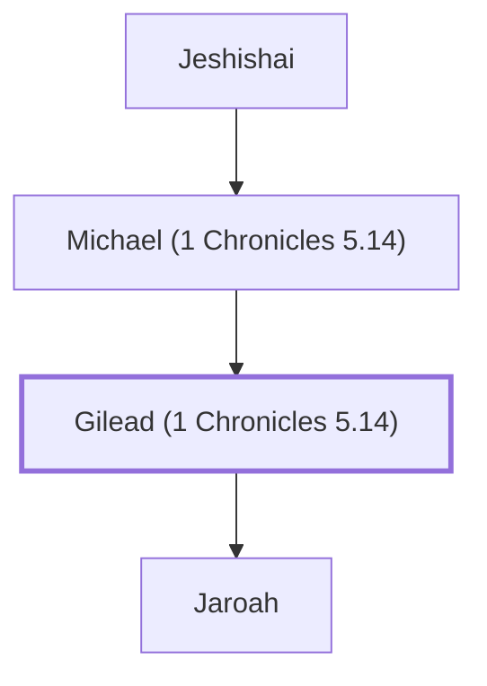

# Gilead (1 Chronicles 5.14)

Descendant of Manasseh; son of Michael; father of Jaroah.

**Original-language names:** גִּלְעָד (H1568)

## When

- **Placed around:** [[connections/timeline/11th century BC|1060 BC]] *(Ussher: the median date of the passages naming them)*

## Family

- **Father:** [[connections/people/Michael (1 Chronicles 5.14)|Michael (1 Chronicles 5.14)]]
- **Children:** [[connections/people/Jaroah|Jaroah]]
- **Tribe or nation:** Tribe of Gad

**Line of descent** (5 generations, father to son): [[connections/people/Buz (1 Chronicles 5.14)|Buz (1 Chronicles 5.14)]] → [[connections/people/Jahdo|Jahdo]] → [[connections/people/Jeshishai|Jeshishai]] → [[connections/people/Michael (1 Chronicles 5.14)|Michael (1 Chronicles 5.14)]] → **Gilead (1 Chronicles 5.14)**

**Family group:** [[connections/genealogy/Family of Buz (1 Chronicles 5.14)|Family of Buz (1 Chronicles 5.14)]], generation 5

## Appears in

[[connections/chapters/13-1-chronicles/1 Chronicles 5|1 Chronicles 5]]

## Appears in the same verse as

[[connections/people/Abihail (1 Chronicles 5.14)|Abihail (1 Chronicles 5.14)]] · [[connections/people/Buz (1 Chronicles 5.14)|Buz (1 Chronicles 5.14)]] · [[connections/people/Huri|Huri]] · [[connections/people/Jahdo|Jahdo]] · [[connections/people/Jaroah|Jaroah]] · [[connections/people/Jeshishai|Jeshishai]] · [[connections/people/Michael (1 Chronicles 5.14)|Michael (1 Chronicles 5.14)]]
