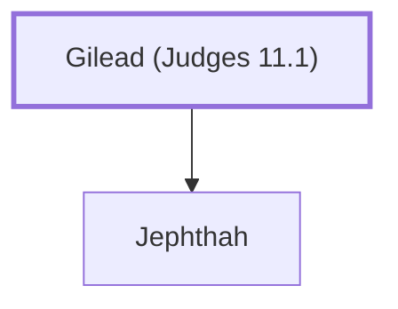

# Gilead (Judges 11.1)

Father of Jephthah, a judge of Israel.

**Original-language names:** גִּלְעָד (H1568)

## Family

- **Children:** [[connections/people/Jephthah|Jephthah]]

**Family group:** [[connections/genealogy/Family of Gilead (Judges 11.1)|Family of Gilead (Judges 11.1)]], generation 1

## Appears in

[[connections/chapters/07-judges/Judges 11|Judges 11 (2)]]

## Appears in the same verse as

[[connections/people/Jephthah|Jephthah (2)]]
