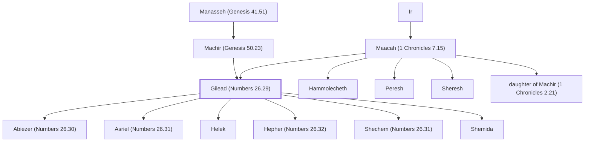

# Gilead (Numbers 26.29)

Son of Machir; grandson of Manasseh; father of six sons.

**Original-language names:** גִּלְעָד (H1568)

## When

- **Placed around:** [[connections/timeline/15th century BC|1452 BC]] *(Ussher: the median date of the passages naming them)*

## Family

- **Father:** [[connections/people/Machir (Genesis 50.23)|Machir (Genesis 50.23)]]
- **Mother:** [[connections/people/Maacah (1 Chronicles 7.15)|Maacah (1 Chronicles 7.15) (uncertain)]]
- **Brothers and sisters:** [[connections/people/Hammolecheth|Hammolecheth]], [[connections/people/Peresh|Peresh]], [[connections/people/Sheresh|Sheresh]], [[connections/people/daughter of Machir (1 Chronicles 2.21)|daughter of Machir (1 Chronicles 2.21)]]
- **Children:** [[connections/people/Abiezer (Numbers 26.30)|Abiezer (Numbers 26.30)]], [[connections/people/Asriel (Numbers 26.31)|Asriel (Numbers 26.31)]], [[connections/people/Helek|Helek]], [[connections/people/Hepher (Numbers 26.32)|Hepher (Numbers 26.32)]], [[connections/people/Shechem (Numbers 26.31)|Shechem (Numbers 26.31)]], [[connections/people/Shemida|Shemida]]
- **Tribe or nation:** Tribe of Manasseh

**Line of descent** (27 generations, father to son): [[connections/people/Adam|Adam]] → [[connections/people/Seth|Seth]] → [[connections/people/Enosh|Enosh]] → [[connections/people/Kenan|Kenan]] → [[connections/people/Mahalalel (Genesis 5.12)|Mahalalel (Genesis 5.12)]] → [[connections/people/Jared|Jared]] → [[connections/people/Enoch (Genesis 5.18)|Enoch (Genesis 5.18)]] → [[connections/people/Methuselah|Methuselah]] → [[connections/people/Lamech (Genesis 5.25)|Lamech (Genesis 5.25)]] → [[connections/people/Noah (Genesis 5.29)|Noah (Genesis 5.29)]] → [[connections/people/Shem|Shem]] → [[connections/people/Arpachshad|Arpachshad]] → [[connections/people/Cainan|Cainan]] → [[connections/people/Shelah (Genesis 10.24)|Shelah (Genesis 10.24)]] → [[connections/people/Eber (Genesis 10.21)|Eber (Genesis 10.21)]] → [[connections/people/Peleg|Peleg]] → [[connections/people/Reu|Reu]] → [[connections/people/Serug|Serug]] → [[connections/people/Nahor (Genesis 11.22)|Nahor (Genesis 11.22)]] → [[connections/people/Terah|Terah]] → [[connections/people/Abraham|Abraham]] → [[connections/people/Isaac|Isaac]] → [[connections/people/Israel|Israel]] → [[connections/people/Joseph (Genesis 30.24)|Joseph (Genesis 30.24)]] → [[connections/people/Manasseh (Genesis 41.51)|Manasseh (Genesis 41.51)]] → [[connections/people/Machir (Genesis 50.23)|Machir (Genesis 50.23)]] → **Gilead (Numbers 26.29)**

**Family group:** [[connections/genealogy/Family of Adam|Family of Adam]], generation 27

## Appears in

[[connections/chapters/04-numbers/Numbers 26|Numbers 26 (2)]] · [[connections/chapters/04-numbers/Numbers 27|Numbers 27]] · [[connections/chapters/06-joshua/Joshua 17|Joshua 17 (2)]] · [[connections/chapters/13-1-chronicles/1 Chronicles 2|1 Chronicles 2 (2)]] · [[connections/chapters/13-1-chronicles/1 Chronicles 7|1 Chronicles 7 (2)]]

## Appears in the same verse as

[[connections/people/Machir (Genesis 50.23)|Machir (Genesis 50.23) (8)]] · [[connections/people/Manasseh (Genesis 41.51)|Manasseh (Genesis 41.51) (6)]] · [[connections/people/Hepher (Numbers 26.32)|Hepher (Numbers 26.32) (2)]] · [[connections/people/Hoglah|Hoglah (2)]] · [[connections/people/Joseph (Genesis 30.24)|Joseph (Genesis 30.24) (2)]] · [[connections/people/Mahlah (Numbers 26.33)|Mahlah (Numbers 26.33) (2)]] · [[connections/people/Milcah (Numbers 26.33)|Milcah (Numbers 26.33) (2)]] · [[connections/people/Noah (Numbers 26.33)|Noah (Numbers 26.33) (2)]] · [[connections/people/Tirzah|Tirzah (2)]] · [[connections/people/Zelophehad|Zelophehad (2)]] · [[connections/people/Abiezer (Numbers 26.30)|Abiezer (Numbers 26.30)]] · [[connections/people/Aram (Genesis 10.22)|Aram (Genesis 10.22)]] · [[connections/people/Asriel (1 Chronicles 7.14)|Asriel (1 Chronicles 7.14)]] · [[connections/people/Bedan|Bedan]] · [[connections/people/Helek|Helek]] · [[connections/people/Hezron (Genesis 46.12)|Hezron (Genesis 46.12)]] · [[connections/people/Segub (1 Chronicles 2.21)|Segub (1 Chronicles 2.21)]] · [[connections/people/Ulam (1 Chronicles 7.16)|Ulam (1 Chronicles 7.16)]] · [[connections/places/Bashan|Bashan]] · [[connections/places/Geshur|Geshur]] · [[connections/places/Gilead|Gilead]] · [[connections/places/Havvoth-jair|Havvoth-jair]] · [[connections/places/Kenath|Kenath]]
