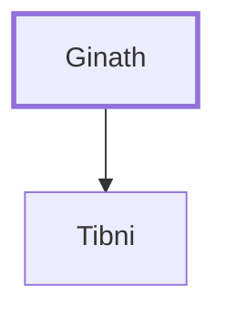

# Ginath

Father of Tibni, who opposed Omri for kingship.

**Original-language names:** גִּינַ֑ת (H1527)

## When

- **Placed around:** [[connections/timeline/10th century BC|929 BC]] *(Ussher: the median date of the passages naming them)*

## Family

- **Children:** [[connections/people/Tibni|Tibni]]

**Family group:** [[connections/genealogy/Family of Ginath|Family of Ginath]], generation 1

## Appears in

[[connections/chapters/11-1-kings/1 Kings 16|1 Kings 16 (2)]]

## Appears in the same verse as

[[connections/people/Omri (1 Kings 16.16)|Omri (1 Kings 16.16) (2)]] · [[connections/people/Tibni|Tibni (2)]] · [[connections/people/Israel|Israel]]
