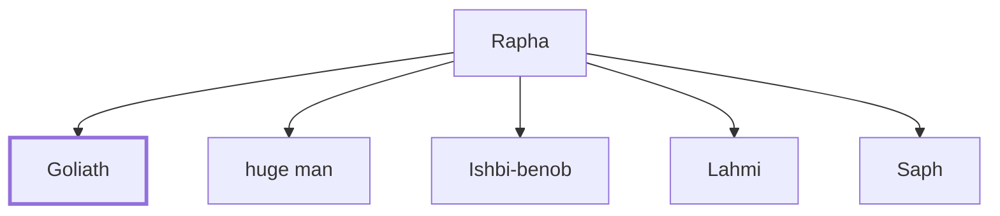

# Goliath

A Philistine giant defeated by David.

**Original-language names:** גׇּלְיַת (H1555)

## When

- **Placed around:** [[connections/timeline/11th century BC|1062 BC]] *(Ussher: the median date of the passages naming them)*

## Family

- **Father:** [[connections/people/Rapha|Rapha]]
- **Brothers and sisters:** [[connections/people/huge man|huge man]], [[connections/people/Ishbi-benob|Ishbi-benob]], [[connections/people/Lahmi|Lahmi]], [[connections/people/Saph|Saph]]

**Family group:** [[connections/genealogy/Family of Rapha|Family of Rapha]], generation 2

## Events

- [[connections/timeline/11th century BC|1067 BC]] · [[connections/events/David Kills Goliath|David Kills Goliath]]

## Appears in

[[connections/chapters/09-1-samuel/1 Samuel 17|1 Samuel 17 (2)]] · [[connections/chapters/09-1-samuel/1 Samuel 21|1 Samuel 21]] · [[connections/chapters/09-1-samuel/1 Samuel 22|1 Samuel 22]] · [[connections/chapters/10-2-samuel/2 Samuel 21|2 Samuel 21]] · [[connections/chapters/13-1-chronicles/1 Chronicles 20|1 Chronicles 20]]

## Appears in the same verse as

[[connections/people/David|David (2)]] · [[connections/people/Elhanan (2 Samuel 21.19)|Elhanan (2 Samuel 21.19) (2)]] · [[connections/people/Jaare-oregim|Jaare-oregim (2)]] · [[connections/people/Lahmi|Lahmi (2)]] · [[connections/places/Gath|Gath (2)]] · [[connections/places/Elah Valley|Elah Valley]] · [[connections/places/Gezer|Gezer]]
