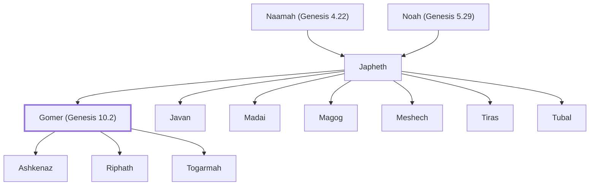

# Gomer (Genesis 10.2)

Son of Japheth; father of Ashkenaz, Riphath, and Togarmah.

**Original-language names:** גֹּ֫מֶר (H1586)

## When

- **Placed around:** [[connections/timeline/6th century BC|587 BC]] *(Ussher: the median date of the passages naming them)*

## Family

- **Father:** [[connections/people/Japheth|Japheth]]
- **Brothers and sisters:** [[connections/people/Javan|Javan]], [[connections/people/Madai|Madai]], [[connections/people/Magog|Magog]], [[connections/people/Meshech|Meshech]], [[connections/people/Tiras|Tiras]], [[connections/people/Tubal|Tubal]]
- **Children:** [[connections/people/Ashkenaz|Ashkenaz]], [[connections/people/Riphath|Riphath]], [[connections/people/Togarmah|Togarmah]]
- **Tribe or nation:** Early Patriarch

**Line of descent** (12 generations, father to son): [[connections/people/Adam|Adam]] → [[connections/people/Seth|Seth]] → [[connections/people/Enosh|Enosh]] → [[connections/people/Kenan|Kenan]] → [[connections/people/Mahalalel (Genesis 5.12)|Mahalalel (Genesis 5.12)]] → [[connections/people/Jared|Jared]] → [[connections/people/Enoch (Genesis 5.18)|Enoch (Genesis 5.18)]] → [[connections/people/Methuselah|Methuselah]] → [[connections/people/Lamech (Genesis 5.25)|Lamech (Genesis 5.25)]] → [[connections/people/Noah (Genesis 5.29)|Noah (Genesis 5.29)]] → [[connections/people/Japheth|Japheth]] → **Gomer (Genesis 10.2)**

**Family group:** [[connections/genealogy/Family of Adam|Family of Adam]], generation 12

## Appears in

[[connections/chapters/01-genesis/Genesis 10|Genesis 10 (2)]] · [[connections/chapters/13-1-chronicles/1 Chronicles 1|1 Chronicles 1 (2)]] · [[connections/chapters/26-ezekiel/Ezekiel 38|Ezekiel 38]]

## Appears in the same verse as

[[connections/people/Ashkenaz|Ashkenaz (2)]] · [[connections/people/Japheth|Japheth (2)]] · [[connections/people/Javan|Javan (2)]] · [[connections/people/Madai|Madai (2)]] · [[connections/people/Magog|Magog (2)]] · [[connections/people/Meshech|Meshech (2)]] · [[connections/people/Riphath|Riphath (2)]] · [[connections/people/Tiras|Tiras (2)]] · [[connections/people/Togarmah|Togarmah (2)]] · [[connections/people/Tubal|Tubal (2)]] · [[connections/places/Beth-togarmah|Beth-togarmah]]
