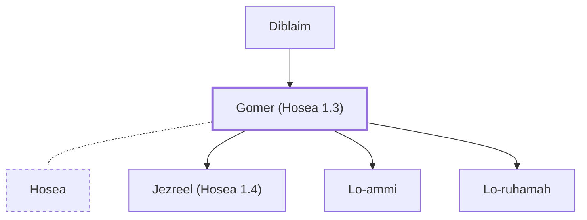

# Gomer (Hosea 1.3)

Hosea's wife, a promiscuous woman.

**Original-language names:** גֹּ֫מֶר (H1586)

## When

- **Placed around:** [[connections/timeline/8th century BC|785 BC]] *(Ussher: the median date of the passages naming them)*

## Family

- **Father:** [[connections/people/Diblaim|Diblaim]]
- **Spouses:** [[connections/people/Hosea|Hosea]]
- **Children:** [[connections/people/Jezreel (Hosea 1.4)|Jezreel (Hosea 1.4)]], [[connections/people/Lo-ammi|Lo-ammi]], [[connections/people/Lo-ruhamah|Lo-ruhamah]]

**Family group:** [[connections/genealogy/Family of Beeri (Hosea 1.1)|Family of Beeri (Hosea 1.1)]], generation 2

## Appears in

[[connections/chapters/28-hosea/Hosea 1|Hosea 1]]

## Appears in the same verse as

[[connections/people/Diblaim|Diblaim]]
