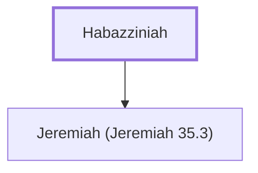

# Habazziniah

Grandfather of Jaazaniah, a Rechabite leader.

**Original-language names:** חֲבַצִּנְיָה (H2262)

## When

- **Placed around:** [[connections/timeline/7th century BC|607 BC]] *(Ussher: the median date of the passages naming them)*

## Family

- **Children:** [[connections/people/Jeremiah (Jeremiah 35.3)|Jeremiah (Jeremiah 35.3)]]

**Family group:** [[connections/genealogy/Family of Habazziniah|Family of Habazziniah]], generation 1

## Appears in

[[connections/chapters/24-jeremiah/Jeremiah 35|Jeremiah 35]]

## Appears in the same verse as

[[connections/people/Jaazaniah (Jeremiah 35.3)|Jaazaniah (Jeremiah 35.3)]] · [[connections/people/Jeremiah (Jeremiah 35.3)|Jeremiah (Jeremiah 35.3)]]
