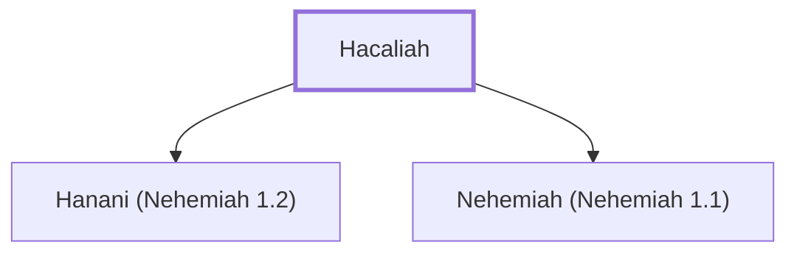

# Hacaliah

Father of Nehemiah, the governor of Judah.

**Original-language names:** חֲכַלְיָה (H2446)

## When

- **Placed around:** [[connections/timeline/5th century BC|445 BC]] *(Ussher: the median date of the passages naming them)*

## Family

- **Children:** [[connections/people/Hanani (Nehemiah 1.2)|Hanani (Nehemiah 1.2)]], [[connections/people/Nehemiah (Nehemiah 1.1)|Nehemiah (Nehemiah 1.1)]]

**Family group:** [[connections/genealogy/Family of Hacaliah|Family of Hacaliah]], generation 1

## Appears in

[[connections/chapters/16-nehemiah/Nehemiah 1|Nehemiah 1]] · [[connections/chapters/16-nehemiah/Nehemiah 10|Nehemiah 10]]

## Appears in the same verse as

[[connections/people/Nehemiah (Nehemiah 1.1)|Nehemiah (Nehemiah 1.1) (2)]] · [[connections/people/Zedekiah (Nehemiah 10.2)|Zedekiah (Nehemiah 10.2)]] · [[connections/places/Susa|Susa]]
