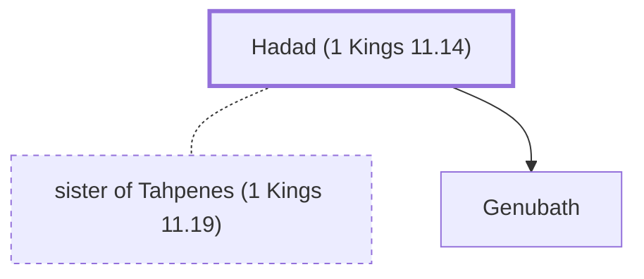

# Hadad (1 Kings 11.14)

An Edomite prince who opposed Solomon.

**Original-language names:** הֲדַד (H1908) · אֲדַד (H0111)

## When

- **Placed around:** [[connections/timeline/10th century BC|984 BC]] *(Ussher: the median date of the passages naming them)*

## Family

- **Spouses:** [[connections/people/sister of Tahpenes (1 Kings 11.19)|sister of Tahpenes (1 Kings 11.19)]]
- **Children:** [[connections/people/Genubath|Genubath]]
- **Tribe or nation:** Edom

**Family group:** [[connections/genealogy/Family of father of Tahpenes (1 Kings 11.19)|Family of father of Tahpenes (1 Kings 11.19)]], generation 2

## Appears in

[[connections/chapters/11-1-kings/1 Kings 11|1 Kings 11 (5)]]

## Appears in the same verse as

[[connections/people/Pharaoh (1 Kings 3.1)|Pharaoh (1 Kings 3.1) (2)]] · [[connections/people/Solomon|Solomon (2)]] · [[connections/places/Egypt|Egypt (2)]] · [[connections/people/David|David]] · [[connections/people/Israel|Israel]] · [[connections/people/Joab (1 Samuel 26.6)|Joab (1 Samuel 26.6)]] · [[connections/people/Tahpenes|Tahpenes]] · [[connections/places/Edom|Edom]] · [[connections/places/Syria|Syria]]
