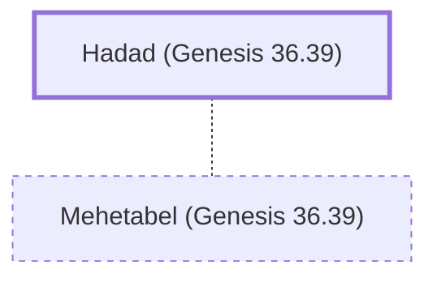

# Hadad (Genesis 36.39)

The last king of Edom before Israelite rule.

**Also called:** Hadar

**Original-language names:** הֲדַד (H1908) · הֲדַר (H1924)

## When

- **Placed around:** [[connections/timeline/19th century BC|1853 BC]] *(Ussher: the median date of the passages naming them)*

## Family

- **Spouses:** [[connections/people/Mehetabel (Genesis 36.39)|Mehetabel (Genesis 36.39)]]
- **Tribe or nation:** Edom

## Appears in

[[connections/chapters/01-genesis/Genesis 36|Genesis 36]] · [[connections/chapters/13-1-chronicles/1 Chronicles 1|1 Chronicles 1 (2)]]

## Appears in the same verse as

[[connections/people/Baal-hanan (Genesis 36.38)|Baal-hanan (Genesis 36.38) (2)]] · [[connections/people/Matred|Matred (2)]] · [[connections/people/Mehetabel (Genesis 36.39)|Mehetabel (Genesis 36.39) (2)]] · [[connections/people/Mezahab|Mezahab (2)]] · [[connections/places/Pau|Pau (2)]] · [[connections/people/Achbor (Genesis 36.38)|Achbor (Genesis 36.38)]] · [[connections/people/Alvah|Alvah]] · [[connections/people/Esau|Esau]] · [[connections/people/Jetheth|Jetheth]] · [[connections/people/Timna|Timna]]
