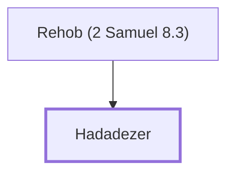

# Hadadezer

King of Zobah, defeated by David.

**Original-language names:** הֲדַרְעֶ֫זֶר (H1909) · הֲדַדְעֶ֫זֶר (H1928)

## When

- **Placed around:** [[connections/timeline/11th century BC|1040 BC]] *(Ussher: the median date of the passages naming them)*

## Family

- **Father:** [[connections/people/Rehob (2 Samuel 8.3)|Rehob (2 Samuel 8.3)]]
- **Tribe or nation:** Syria

**Family group:** [[connections/genealogy/Family of Rehob (2 Samuel 8.3)|Family of Rehob (2 Samuel 8.3)]], generation 2

## Appears in

[[connections/chapters/10-2-samuel/2 Samuel 8|2 Samuel 8 (7)]] · [[connections/chapters/10-2-samuel/2 Samuel 10|2 Samuel 10 (2)]] · [[connections/chapters/11-1-kings/1 Kings 11|1 Kings 11]] · [[connections/chapters/13-1-chronicles/1 Chronicles 18|1 Chronicles 18 (6)]] · [[connections/chapters/13-1-chronicles/1 Chronicles 19|1 Chronicles 19 (2)]]

## Appears in the same verse as

[[connections/people/David|David (13)]] · [[connections/places/Zobah|Zobah (7)]] · [[connections/places/Syria|Syria (6)]] · [[connections/people/Toi|Toi (4)]] · [[connections/places/Euphrates|Euphrates (4)]] · [[connections/people/Israel|Israel (3)]] · [[connections/places/Ammon|Ammon (3)]] · [[connections/people/Joram (2 Samuel 8.10)|Joram (2 Samuel 8.10) (2)]] · [[connections/people/Rehob (2 Samuel 8.3)|Rehob (2 Samuel 8.3) (2)]] · [[connections/people/Shobach|Shobach (2)]] · [[connections/places/Berothah|Berothah (2)]] · [[connections/places/Damascus|Damascus (2)]] · [[connections/places/Hamath|Hamath (2)]] · [[connections/places/Jerusalem|Jerusalem (2)]] · [[connections/people/Eliada (1 Kings 11.23)|Eliada (1 Kings 11.23)]] · [[connections/people/Rezon|Rezon]] · [[connections/people/Solomon|Solomon]] · [[connections/places/Amalek|Amalek]] · [[connections/places/Betah|Betah]] · [[connections/places/Edom|Edom]] · [[connections/places/Helam|Helam]] · [[connections/places/Moab|Moab]] · [[connections/places/Tibhath|Tibhath]]
