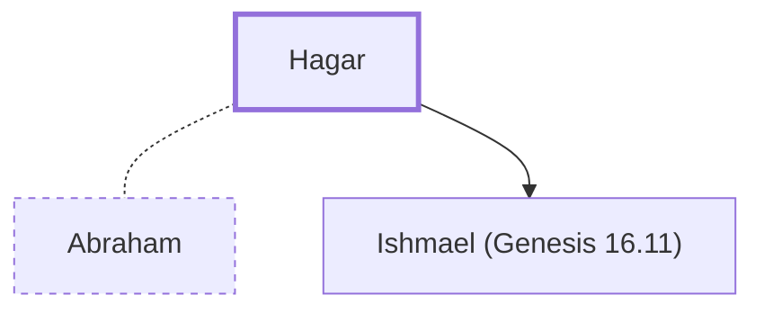

# Hagar

Sarah's Egyptian maidservant; mother of Ishmael.

**Original-language names:** הָגָר (H1904) · Ἄγαρ (G0028)

## When

- **Placed around:** [[connections/timeline/19th century BC|1893 BC]] *(Ussher: the median date of the passages naming them)*

## Family

- **Spouses:** [[connections/people/Abraham|Abraham]]
- **Children:** [[connections/people/Ishmael (Genesis 16.11)|Ishmael (Genesis 16.11)]]

**Family group:** [[connections/genealogy/Family of Adam|Family of Adam]], generation 21

## Events

- [[connections/timeline/20th century BC|1910 BC]] · [[connections/events/Birth of Ishmael|Birth of Ishmael]]

## Appears in

[[connections/chapters/01-genesis/Genesis 16|Genesis 16 (6)]] · [[connections/chapters/01-genesis/Genesis 21|Genesis 21 (3)]] · [[connections/chapters/01-genesis/Genesis 25|Genesis 25]] · [[connections/chapters/48-galatians/Galatians 4|Galatians 4 (2)]]

## Appears in the same verse as

[[connections/people/Abraham|Abraham (7)]] · [[connections/people/Sarah|Sarah (5)]] · [[connections/people/Ishmael (Genesis 16.11)|Ishmael (Genesis 16.11) (3)]] · [[connections/places/Sinai|Sinai (2)]] · [[connections/places/Arabia|Arabia]] · [[connections/places/Beersheba|Beersheba]] · [[connections/places/Canaan|Canaan]] · [[connections/places/Jerusalem|Jerusalem]]
