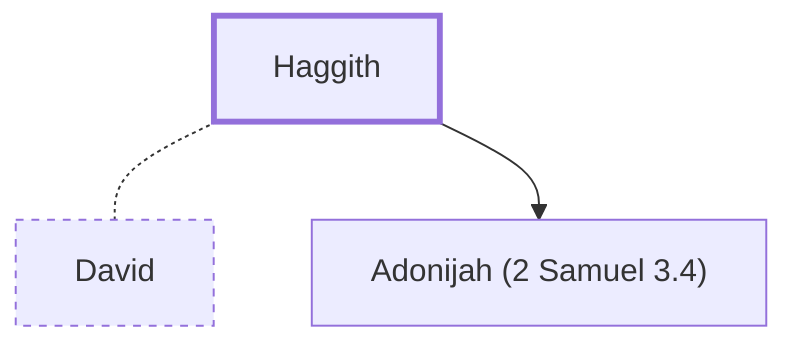

# Haggith

One of David's wives; mother of Adonijah.

**Original-language names:** חַגִּית (H2294)

## When

- **Placed around:** [[connections/timeline/11th century BC|1015 BC]] *(Ussher: the median date of the passages naming them)*

## Family

- **Spouses:** [[connections/people/David|David]]
- **Children:** [[connections/people/Adonijah (2 Samuel 3.4)|Adonijah (2 Samuel 3.4)]]

**Family group:** [[connections/genealogy/Family of Adam|Family of Adam]], generation 36

## Appears in

[[connections/chapters/10-2-samuel/2 Samuel 3|2 Samuel 3]] · [[connections/chapters/11-1-kings/1 Kings 1|1 Kings 1 (2)]] · [[connections/chapters/11-1-kings/1 Kings 2|1 Kings 2]] · [[connections/chapters/13-1-chronicles/1 Chronicles 3|1 Chronicles 3]]

## Appears in the same verse as

[[connections/people/Adonijah (2 Samuel 3.4)|Adonijah (2 Samuel 3.4) (5)]] · [[connections/people/Bathsheba|Bathsheba (2)]] · [[connections/people/Solomon|Solomon (2)]] · [[connections/people/Abital|Abital]] · [[connections/people/Absalom|Absalom]] · [[connections/people/David|David]] · [[connections/people/Maacah (2 Samuel 3.3)|Maacah (2 Samuel 3.3)]] · [[connections/people/Nathan (2 Samuel 7.2)|Nathan (2 Samuel 7.2)]] · [[connections/people/Shephatiah (2 Samuel 3.4)|Shephatiah (2 Samuel 3.4)]] · [[connections/people/Talmai (2 Samuel 3.3)|Talmai (2 Samuel 3.3)]] · [[connections/places/Geshur|Geshur]]
