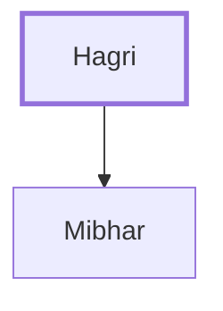

# Hagri

A Gadite, father of Mibhar, one of David's mighty men.

**Original-language names:** הַגְרִי (H1905)

## When

- **Placed around:** [[connections/timeline/11th century BC|1055 BC]] *(Ussher: the median date of the passages naming them)*

## Family

- **Children:** [[connections/people/Mibhar|Mibhar]]

**Family group:** [[connections/genealogy/Family of Hagri|Family of Hagri]], generation 1

## Appears in

[[connections/chapters/13-1-chronicles/1 Chronicles 11|1 Chronicles 11]]

## Appears in the same verse as

[[connections/people/Joel (1 Chronicles 11.38)|Joel (1 Chronicles 11.38)]] · [[connections/people/Mibhar|Mibhar]] · [[connections/people/Nathan (2 Samuel 23.36)|Nathan (2 Samuel 23.36)]]
