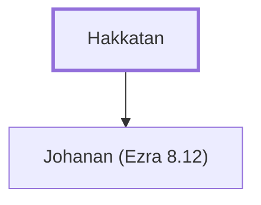

# Hakkatan

Father of Johanan, a leader who returned from Babylon.

**Original-language names:** קָטָן (H6997)

## When

- **Placed around:** [[connections/timeline/5th century BC|457 BC]] *(Ussher: the median date of the passages naming them)*

## Family

- **Children:** [[connections/people/Johanan (Ezra 8.12)|Johanan (Ezra 8.12)]]

**Family group:** [[connections/genealogy/Family of Hakkatan|Family of Hakkatan]], generation 1

## Appears in

[[connections/chapters/15-ezra/Ezra 8|Ezra 8]]

## Appears in the same verse as

[[connections/people/Azgad (Ezra 2.12)|Azgad (Ezra 2.12)]] · [[connections/people/Johanan (Ezra 8.12)|Johanan (Ezra 8.12)]]
