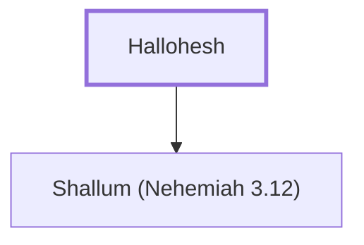

# Hallohesh

Father of Shallum, a leader who helped repair Jerusalem's wall.

**Original-language names:** הַלּוֹחֵשׁ (H3873)

## When

- **Placed around:** [[connections/timeline/5th century BC|445 BC]] *(Ussher: the median date of the passages naming them)*

## Family

- **Children:** [[connections/people/Shallum (Nehemiah 3.12)|Shallum (Nehemiah 3.12)]]

**Family group:** [[connections/genealogy/Family of Hallohesh|Family of Hallohesh]], generation 1

## Appears in

[[connections/chapters/16-nehemiah/Nehemiah 3|Nehemiah 3]] · [[connections/chapters/16-nehemiah/Nehemiah 10|Nehemiah 10]]

## Appears in the same verse as

[[connections/people/Pilha|Pilha]] · [[connections/people/Shallum (Nehemiah 3.12)|Shallum (Nehemiah 3.12)]] · [[connections/people/Shobek|Shobek]] · [[connections/places/Jerusalem|Jerusalem]]
