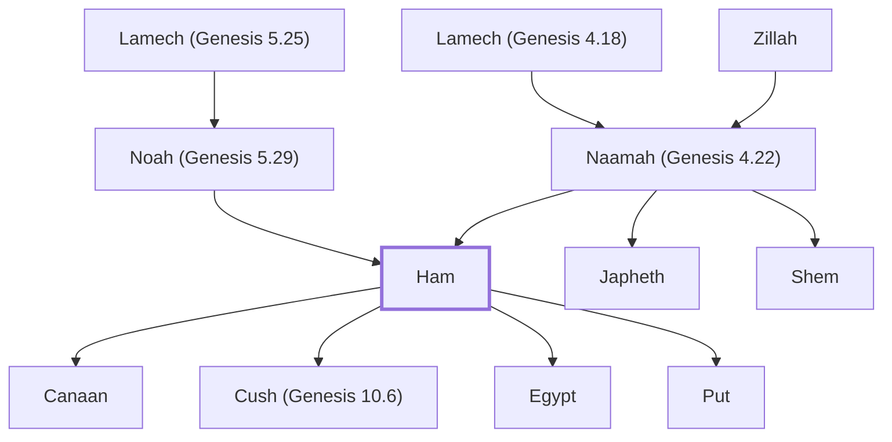

# Ham

One of Noah's three sons, father of Canaan.

**Original-language names:** חָם (H2526)

## When

- **Placed around:** [[connections/timeline/24th century BC|2348 BC]] *(Ussher: the median date of the passages naming them)*

## Family

- **Father:** [[connections/people/Noah (Genesis 5.29)|Noah (Genesis 5.29)]]
- **Mother:** [[connections/people/Naamah (Genesis 4.22)|Naamah (Genesis 4.22) (uncertain)]]
- **Brothers and sisters:** [[connections/people/Japheth|Japheth]], [[connections/people/Shem|Shem]]
- **Children:** [[connections/people/Canaan|Canaan]], [[connections/people/Cush (Genesis 10.6)|Cush (Genesis 10.6)]], [[connections/people/Egypt|Egypt]], [[connections/people/Put|Put]]
- **Tribe or nation:** Early Patriarch

**Line of descent** (11 generations, father to son): [[connections/people/Adam|Adam]] → [[connections/people/Seth|Seth]] → [[connections/people/Enosh|Enosh]] → [[connections/people/Kenan|Kenan]] → [[connections/people/Mahalalel (Genesis 5.12)|Mahalalel (Genesis 5.12)]] → [[connections/people/Jared|Jared]] → [[connections/people/Enoch (Genesis 5.18)|Enoch (Genesis 5.18)]] → [[connections/people/Methuselah|Methuselah]] → [[connections/people/Lamech (Genesis 5.25)|Lamech (Genesis 5.25)]] → [[connections/people/Noah (Genesis 5.29)|Noah (Genesis 5.29)]] → **Ham**

**Family group:** [[connections/genealogy/Family of Adam|Family of Adam]], generation 11

## Events

- [[connections/timeline/24th century BC|2348 BC]] · [[connections/events/The Great Flood begins|The Great Flood begins]]
- [[connections/timeline/24th century BC|2348 BC]] · [[connections/events/The Great Flood|The Great Flood]]
- [[connections/timeline/24th century BC|2348 BC]] · [[connections/events/Water covers the earth|Water covers the earth]]
- [[connections/timeline/24th century BC|2347 BC]] · [[connections/events/The flood subsides|The flood subsides]]
- [[connections/timeline/24th century BC|2347 BC]] · [[connections/events/Leaving the Ark|Leaving the Ark]]
- [[connections/timeline/24th century BC|2346 BC]] · [[connections/events/Noah gets drunk and Canaan is cursed|Noah gets drunk and Canaan is cursed]]

## Appears in

[[connections/chapters/01-genesis/Genesis 5|Genesis 5]] · [[connections/chapters/01-genesis/Genesis 6|Genesis 6]] · [[connections/chapters/01-genesis/Genesis 7|Genesis 7]] · [[connections/chapters/01-genesis/Genesis 9|Genesis 9 (2)]] · [[connections/chapters/01-genesis/Genesis 10|Genesis 10 (3)]] · [[connections/chapters/13-1-chronicles/1 Chronicles 1|1 Chronicles 1 (2)]]

## Appears in the same verse as

[[connections/people/Japheth|Japheth (6)]] · [[connections/people/Noah (Genesis 5.29)|Noah (Genesis 5.29) (6)]] · [[connections/people/Shem|Shem (6)]] · [[connections/people/Canaan|Canaan (4)]] · [[connections/people/Cush (Genesis 10.6)|Cush (Genesis 10.6) (2)]] · [[connections/people/Egypt|Egypt (2)]] · [[connections/people/Put|Put (2)]]
