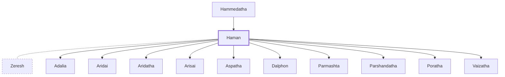

# Haman

A Persian official who plotted to destroy the Jews.

**Original-language names:** הָמָן (H2001)

## When

- **Placed around:** [[connections/timeline/5th century BC|453 BC]] *(Ussher: the median date of the passages naming them)*

## Family

- **Father:** [[connections/people/Hammedatha|Hammedatha]]
- **Spouses:** [[connections/people/Zeresh|Zeresh]]
- **Children:** [[connections/people/Adalia|Adalia]], [[connections/people/Aridai|Aridai]], [[connections/people/Aridatha|Aridatha]], [[connections/people/Arisai|Arisai]], [[connections/people/Aspatha|Aspatha]], [[connections/people/Dalphon|Dalphon]], [[connections/people/Parmashta|Parmashta]], [[connections/people/Parshandatha|Parshandatha]], [[connections/people/Poratha|Poratha]], [[connections/people/Vaizatha|Vaizatha]]
- **Tribe or nation:** Persian

**Family group:** [[connections/genealogy/Family of Hammedatha|Family of Hammedatha]], generation 2

## Appears in

[[connections/chapters/17-esther/Esther 3|Esther 3 (11)]] · [[connections/chapters/17-esther/Esther 4|Esther 4]] · [[connections/chapters/17-esther/Esther 5|Esther 5 (8)]] · [[connections/chapters/17-esther/Esther 6|Esther 6 (9)]] · [[connections/chapters/17-esther/Esther 7|Esther 7 (6)]] · [[connections/chapters/17-esther/Esther 8|Esther 8 (5)]] · [[connections/chapters/17-esther/Esther 9|Esther 9 (5)]]

## Appears in the same verse as

[[connections/people/Mordecai (Esther 2.5)|Mordecai (Esther 2.5) (17)]] · [[connections/people/Esther|Esther (14)]] · [[connections/people/Ahasuerus|Ahasuerus (7)]] · [[connections/people/Hammedatha|Hammedatha (5)]] · [[connections/places/Susa|Susa (4)]] · [[connections/people/Zeresh|Zeresh (3)]] · [[connections/people/Harbona|Harbona]]
