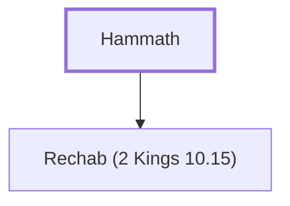

# Hammath

A Kenite clan, descendants of Salma.

**Original-language names:** חַמַּת (H2575b)

## When

- **Placed around:** [[connections/timeline/15th century BC|1470 BC]] *(Ussher: the median date of the passages naming them)*

## Family

- **Children:** [[connections/people/Rechab (2 Kings 10.15)|Rechab (2 Kings 10.15)]]
- **Tribe or nation:** Tribe of Judah(?)

**Family group:** [[connections/genealogy/Family of Hammath|Family of Hammath]], generation 1

## Appears in

[[connections/chapters/13-1-chronicles/1 Chronicles 2|1 Chronicles 2]]

## Appears in the same verse as

[[connections/people/Rechab (2 Kings 10.15)|Rechab (2 Kings 10.15)]] · [[connections/places/Jabez|Jabez]]
