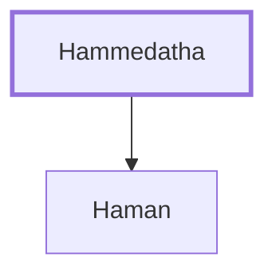

# Hammedatha

The father of Haman, the enemy of the Jews.

**Original-language names:** הַמְּדָתָא (H4099)

## When

- **Placed around:** [[connections/timeline/5th century BC|453 BC]] *(Ussher: the median date of the passages naming them)*

## Family

- **Children:** [[connections/people/Haman|Haman]]

**Family group:** [[connections/genealogy/Family of Hammedatha|Family of Hammedatha]], generation 1

## Appears in

[[connections/chapters/17-esther/Esther 3|Esther 3 (2)]] · [[connections/chapters/17-esther/Esther 8|Esther 8]] · [[connections/chapters/17-esther/Esther 9|Esther 9 (2)]]

## Appears in the same verse as

[[connections/people/Haman|Haman (5)]] · [[connections/people/Ahasuerus|Ahasuerus]]
