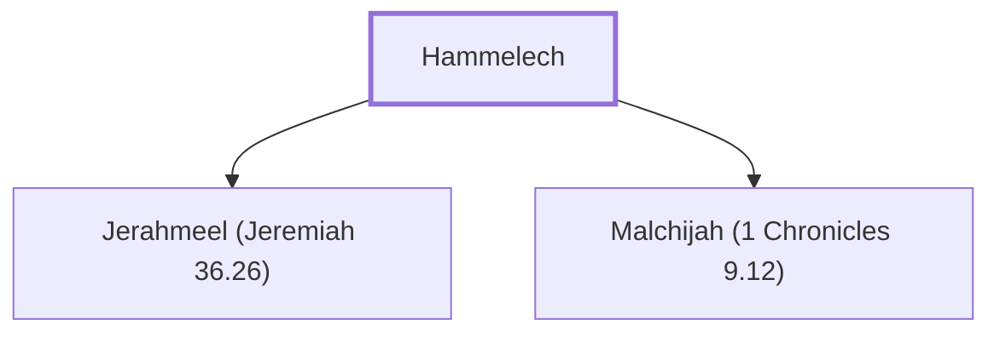

# Hammelech

Father of Jerahmeel and Malchijah (or 'Malchiah'), officials during Jeremiah's time.

**Original-language names:** הַמֶּלֶךְ (H4428)

## When

- **Placed around:** [[connections/timeline/6th century BC|598 BC]] *(Ussher: the median date of the passages naming them)*

## Family

- **Children:** [[connections/people/Jerahmeel (Jeremiah 36.26)|Jerahmeel (Jeremiah 36.26)]], [[connections/people/Malchijah (1 Chronicles 9.12)|Malchijah (1 Chronicles 9.12)]]

**Family group:** [[connections/genealogy/Family of Hammelech|Family of Hammelech]], generation 1

## Appears in

[[connections/chapters/24-jeremiah/Jeremiah 36|Jeremiah 36]] · [[connections/chapters/24-jeremiah/Jeremiah 38|Jeremiah 38]]

## Appears in the same verse as

[[connections/people/Jeremiah (2 Chronicles 35.25)|Jeremiah (2 Chronicles 35.25) (2)]] · [[connections/people/Abdeel|Abdeel]] · [[connections/people/Azriel (Jeremiah 36.26)|Azriel (Jeremiah 36.26)]] · [[connections/people/Baruch (Jeremiah 32.12)|Baruch (Jeremiah 32.12)]] · [[connections/people/Jerahmeel (Jeremiah 36.26)|Jerahmeel (Jeremiah 36.26)]] · [[connections/people/Malchiah|Malchiah]] · [[connections/people/Seraiah (Jeremiah 36.26)|Seraiah (Jeremiah 36.26)]] · [[connections/people/Shelemiah (Jeremiah 36.26)|Shelemiah (Jeremiah 36.26)]]
