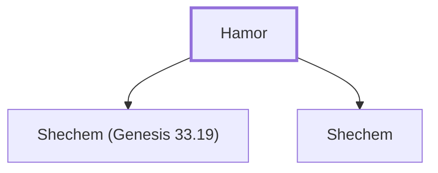

# Hamor

A Hivite prince, father of Shechem.

**Original-language names:** חֲמוֹר (H2544) · Ἐμμόρ (G1697)

## When

- **Placed around:** [[connections/timeline/18th century BC|1732 BC]] *(Ussher: the median date of the passages naming them)*

## Family

- **Children:** [[connections/people/Shechem (Genesis 33.19)|Shechem (Genesis 33.19)]], [[connections/places/Shechem|Shechem (founder)]]

**Family group:** [[connections/genealogy/Family of Hamor|Family of Hamor]], generation 1

## Appears in

[[connections/chapters/01-genesis/Genesis 33|Genesis 33]] · [[connections/chapters/01-genesis/Genesis 34|Genesis 34 (9)]] · [[connections/chapters/06-joshua/Joshua 24|Joshua 24]] · [[connections/chapters/07-judges/Judges 9|Judges 9]] · [[connections/chapters/44-acts/Acts 7|Acts 7]]

## Appears in the same verse as

[[connections/people/Shechem (Genesis 33.19)|Shechem (Genesis 33.19) (10)]] · [[connections/people/Israel|Israel (3)]] · [[connections/places/Shechem|Shechem (3)]] · [[connections/people/Dinah|Dinah (2)]] · [[connections/people/Abimelech (Judges 8.31)|Abimelech (Judges 8.31)]] · [[connections/people/Abraham|Abraham]] · [[connections/people/Ebed (Judges 9.26)|Ebed (Judges 9.26)]] · [[connections/people/Gaal|Gaal]] · [[connections/people/Gideon|Gideon]] · [[connections/people/Joseph (Genesis 30.24)|Joseph (Genesis 30.24)]] · [[connections/people/Zebul|Zebul]] · [[connections/places/Egypt|Egypt]]
