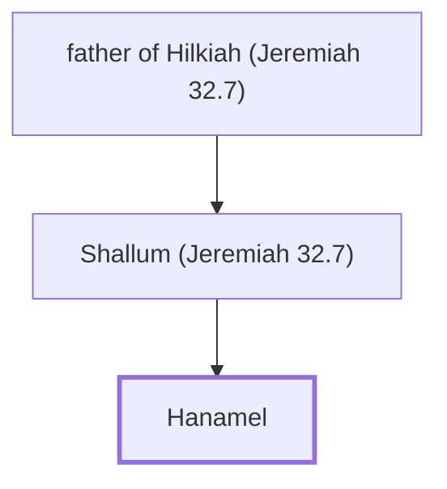

# Hanamel

Jeremiah's cousin, from whom he bought a field.

**Original-language names:** חֲנַמְאֵל (H2601)

## When

- **Placed around:** [[connections/timeline/6th century BC|589 BC]] *(Ussher: the median date of the passages naming them)*

## Family

- **Father:** [[connections/people/Shallum (Jeremiah 32.7)|Shallum (Jeremiah 32.7)]]

**Line of descent** (3 generations, father to son): [[connections/people/father of Hilkiah (Jeremiah 32.7)|father of Hilkiah (Jeremiah 32.7)]] → [[connections/people/Shallum (Jeremiah 32.7)|Shallum (Jeremiah 32.7)]] → **Hanamel**

**Family group:** [[connections/genealogy/Family of father of Hilkiah (Jeremiah 32.7)|Family of father of Hilkiah (Jeremiah 32.7)]], generation 3

## Appears in

[[connections/chapters/24-jeremiah/Jeremiah 32|Jeremiah 32 (4)]]

## Appears in the same verse as

[[connections/places/Anathoth|Anathoth (3)]] · [[connections/people/Baruch (Jeremiah 32.12)|Baruch (Jeremiah 32.12)]] · [[connections/people/Benjamin (Genesis 35.18)|Benjamin (Genesis 35.18)]] · [[connections/people/Mahseiah|Mahseiah]] · [[connections/people/Neriah|Neriah]] · [[connections/people/Shallum (Jeremiah 32.7)|Shallum (Jeremiah 32.7)]]
