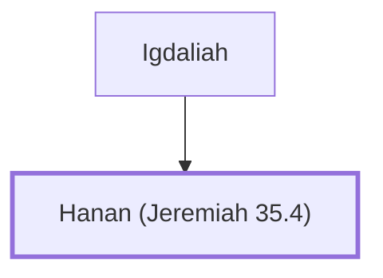

# Hanan (Jeremiah 35.4)

Son of Igdaliah, associated with the Rechabites.

**Original-language names:** חָנָן (H2605)

## When

- **Placed around:** [[connections/timeline/7th century BC|607 BC]] *(Ussher: the median date of the passages naming them)*

## Family

- **Father:** [[connections/people/Igdaliah|Igdaliah]]

**Family group:** [[connections/genealogy/Family of Igdaliah|Family of Igdaliah]], generation 2

## Appears in

[[connections/chapters/24-jeremiah/Jeremiah 35|Jeremiah 35]]

## Appears in the same verse as

[[connections/people/Igdaliah|Igdaliah]] · [[connections/people/Maaseiah (Jeremiah 35.4)|Maaseiah (Jeremiah 35.4)]] · [[connections/people/Shallum (Jeremiah 35.4)|Shallum (Jeremiah 35.4)]]
