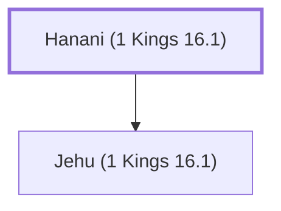

# Hanani (1 Kings 16.1)

A seer who prophesied during the reign of Asa.

**Original-language names:** חֲנָנִי (H2607)

## When

- **Placed around:** [[connections/timeline/10th century BC|930 BC]] *(Ussher: the median date of the passages naming them)*

## Family

- **Children:** [[connections/people/Jehu (1 Kings 16.1)|Jehu (1 Kings 16.1)]]

**Family group:** [[connections/genealogy/Family of Hanani (1 Kings 16.1)|Family of Hanani (1 Kings 16.1)]], generation 1

## Appears in

[[connections/chapters/11-1-kings/1 Kings 16|1 Kings 16 (2)]] · [[connections/chapters/14-2-chronicles/2 Chronicles 16|2 Chronicles 16]] · [[connections/chapters/14-2-chronicles/2 Chronicles 19|2 Chronicles 19]] · [[connections/chapters/14-2-chronicles/2 Chronicles 20|2 Chronicles 20]]

## Appears in the same verse as

[[connections/people/Jehu (1 Kings 16.1)|Jehu (1 Kings 16.1) (4)]] · [[connections/people/Baasha|Baasha (2)]] · [[connections/people/Jehoshaphat (1 Kings 15.24)|Jehoshaphat (1 Kings 15.24) (2)]] · [[connections/people/Asa (1 Kings 15.8)|Asa (1 Kings 15.8)]] · [[connections/people/Israel|Israel]] · [[connections/people/Jeroboam (1 Kings 11.26)|Jeroboam (1 Kings 11.26)]] · [[connections/people/Judah (Genesis 29.35)|Judah (Genesis 29.35)]] · [[connections/places/Syria|Syria]]
