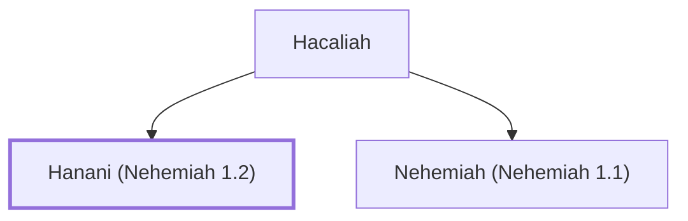

# Hanani (Nehemiah 1.2)

Nehemiah's brother, who reported on Jerusalem's condition.

**Original-language names:** חֲנָנִי (H2607)

## When

- **Placed around:** [[connections/timeline/5th century BC|445 BC]] *(Ussher: the median date of the passages naming them)*

## Family

- **Father:** [[connections/people/Hacaliah|Hacaliah]]
- **Brothers and sisters:** [[connections/people/Nehemiah (Nehemiah 1.1)|Nehemiah (Nehemiah 1.1)]]

**Family group:** [[connections/genealogy/Family of Hacaliah|Family of Hacaliah]], generation 2

## Appears in

[[connections/chapters/16-nehemiah/Nehemiah 1|Nehemiah 1]] · [[connections/chapters/16-nehemiah/Nehemiah 7|Nehemiah 7]]

## Appears in the same verse as

[[connections/places/Jerusalem|Jerusalem (2)]] · [[connections/people/Hananiah (Nehemiah 7.2)|Hananiah (Nehemiah 7.2)]] · [[connections/people/Judah (Genesis 29.35)|Judah (Genesis 29.35)]]
