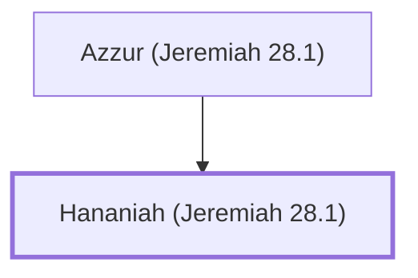

# Hananiah (Jeremiah 28.1)

A false prophet who opposed Jeremiah's prophecies.

**Original-language names:** חֲנַנְיָ֫הוּ (H2608a)

## When

- **Placed around:** [[connections/timeline/6th century BC|595 BC]] *(Ussher: the median date of the passages naming them)*

## Family

- **Father:** [[connections/people/Azzur (Jeremiah 28.1)|Azzur (Jeremiah 28.1)]]

**Family group:** [[connections/genealogy/Family of Azzur (Jeremiah 28.1)|Family of Azzur (Jeremiah 28.1)]], generation 2

## Appears in

[[connections/chapters/24-jeremiah/Jeremiah 28|Jeremiah 28 (8)]]

## Appears in the same verse as

[[connections/people/Jeremiah (2 Chronicles 35.25)|Jeremiah (2 Chronicles 35.25) (5)]] · [[connections/people/Azzur (Jeremiah 28.1)|Azzur (Jeremiah 28.1)]] · [[connections/people/Judah (Genesis 29.35)|Judah (Genesis 29.35)]] · [[connections/people/Nebuchadnezzar|Nebuchadnezzar]] · [[connections/people/Zedekiah (2 Kings 24.17)|Zedekiah (2 Kings 24.17)]] · [[connections/places/Babylon|Babylon]] · [[connections/places/Gibeon|Gibeon]]
