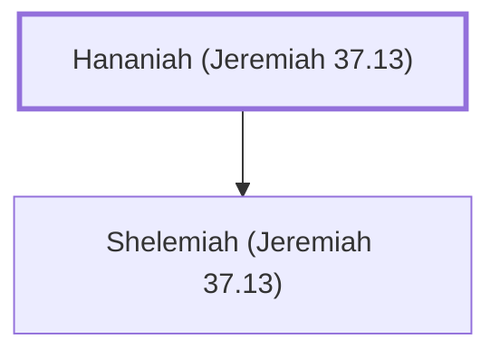

# Hananiah (Jeremiah 37.13)

A gatekeeper during the time of Jeremiah.

**Original-language names:** חֲנַנְיָ֫הוּ (H2608a)

## When

- **Placed around:** [[connections/timeline/6th century BC|598 BC]] *(Ussher: the median date of the passages naming them)*

## Family

- **Children:** [[connections/people/Shelemiah (Jeremiah 37.13)|Shelemiah (Jeremiah 37.13)]]

**Family group:** [[connections/genealogy/Family of Hananiah (Jeremiah 37.13)|Family of Hananiah (Jeremiah 37.13)]], generation 1

## Appears in

[[connections/chapters/24-jeremiah/Jeremiah 37|Jeremiah 37]]

## Appears in the same verse as

[[connections/people/Irijah|Irijah]] · [[connections/people/Jeremiah (2 Chronicles 35.25)|Jeremiah (2 Chronicles 35.25)]] · [[connections/people/Shelemiah (Jeremiah 37.13)|Shelemiah (Jeremiah 37.13)]] · [[connections/places/Benjamin Gate (Jeremiah 20.2)|Benjamin Gate (Jeremiah 20.2)]] · [[connections/places/Chaldea|Chaldea]]
