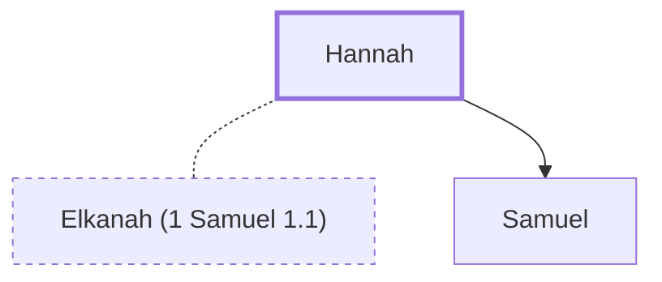

# Hannah

The mother of the prophet Samuel.

**Original-language names:** חַנָּה (H2584)

## When

- **Placed around:** [[connections/timeline/12th century BC|1165 BC]] *(Ussher: the median date of the passages naming them)*

## Family

- **Spouses:** [[connections/people/Elkanah (1 Samuel 1.1)|Elkanah (1 Samuel 1.1)]]
- **Children:** [[connections/people/Samuel|Samuel]]

**Family group:** [[connections/genealogy/Family of Adam|Family of Adam]], generation 44

## Appears in

[[connections/chapters/09-1-samuel/1 Samuel 1|1 Samuel 1 (9)]] · [[connections/chapters/09-1-samuel/1 Samuel 2|1 Samuel 2 (2)]]

## Appears in the same verse as

[[connections/people/Eli|Eli (2)]] · [[connections/people/Elkanah (1 Samuel 1.1)|Elkanah (1 Samuel 1.1) (2)]] · [[connections/people/Samuel|Samuel (2)]] · [[connections/people/Peninnah|Peninnah]] · [[connections/places/Mizpah|Mizpah]] · [[connections/places/Shiloh|Shiloh]]
