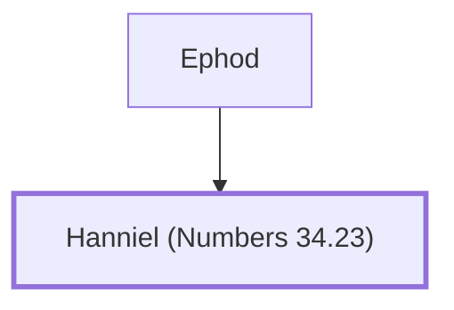

# Hanniel (Numbers 34.23)

The leader of the tribe of Manasseh during the land allotment.

**Original-language names:** חַנִּיאֵל (H2592)

## When

- **Placed around:** [[connections/timeline/15th century BC|1452 BC]] *(Ussher: the median date of the passages naming them)*

## Family

- **Father:** [[connections/people/Ephod|Ephod]]

**Family group:** [[connections/genealogy/Family of Ephod|Family of Ephod]], generation 2

## Appears in

[[connections/chapters/04-numbers/Numbers 34|Numbers 34]]

## Appears in the same verse as

[[connections/people/Ephod|Ephod]] · [[connections/people/Joseph (Genesis 30.24)|Joseph (Genesis 30.24)]] · [[connections/people/Manasseh (Genesis 41.51)|Manasseh (Genesis 41.51)]]
