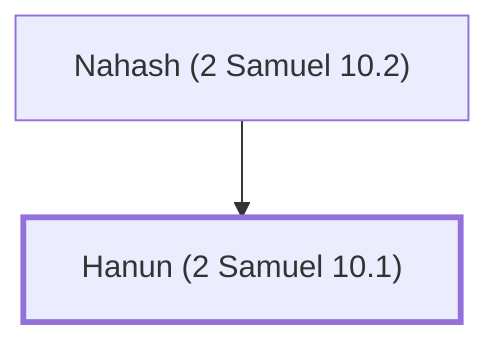

# Hanun (2 Samuel 10.1)

An Ammonite king who mistreated David's envoys.

**Original-language names:** חָנוּן (H2586)

## When

- **Placed around:** [[connections/timeline/11th century BC|1037 BC]] *(Ussher: the median date of the passages naming them)*

## Family

- **Father:** [[connections/people/Nahash (2 Samuel 10.2)|Nahash (2 Samuel 10.2)]]
- **Tribe or nation:** Ammon

**Family group:** [[connections/genealogy/Family of Nahash (2 Samuel 10.2)|Family of Nahash (2 Samuel 10.2)]], generation 2

## Appears in

[[connections/chapters/10-2-samuel/2 Samuel 10|2 Samuel 10 (4)]] · [[connections/chapters/13-1-chronicles/1 Chronicles 19|1 Chronicles 19 (4)]]

## Appears in the same verse as

[[connections/people/David|David (7)]] · [[connections/places/Ammon|Ammon (6)]] · [[connections/people/Nahash (2 Samuel 10.2)|Nahash (2 Samuel 10.2) (2)]] · [[connections/places/Aram-maacah|Aram-maacah]] · [[connections/places/Mesopotamia|Mesopotamia]] · [[connections/places/Zobah|Zobah]]
