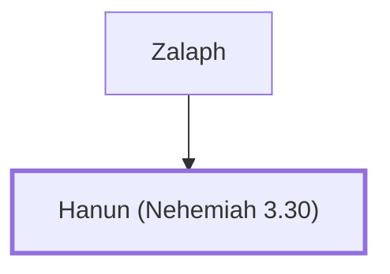

# Hanun (Nehemiah 3.30)

Another repairer of Jerusalem's wall during Nehemiah's time.

**Original-language names:** חָנוּן (H2586)

## When

- **Placed around:** [[connections/timeline/5th century BC|445 BC]] *(Ussher: the median date of the passages naming them)*

## Family

- **Father:** [[connections/people/Zalaph|Zalaph]]

**Family group:** [[connections/genealogy/Family of Zalaph|Family of Zalaph]], generation 2

## Appears in

[[connections/chapters/16-nehemiah/Nehemiah 3|Nehemiah 3]]

## Appears in the same verse as

[[connections/people/Berechiah (Nehemiah 3.4)|Berechiah (Nehemiah 3.4)]] · [[connections/people/Hananiah (Nehemiah 3.30)|Hananiah (Nehemiah 3.30)]] · [[connections/people/Meshullam (Nehemiah 3.4)|Meshullam (Nehemiah 3.4)]] · [[connections/people/Shelemiah (Nehemiah 3.30)|Shelemiah (Nehemiah 3.30)]] · [[connections/people/Zalaph|Zalaph]]
