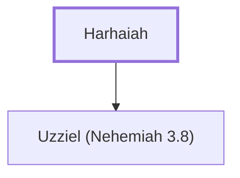

# Harhaiah

A goldsmith whose son helped repair Jerusalem's wall.

**Original-language names:** חַרְחֲיָה (H2736)

## When

- **Placed around:** [[connections/timeline/5th century BC|445 BC]] *(Ussher: the median date of the passages naming them)*

## Family

- **Children:** [[connections/people/Uzziel (Nehemiah 3.8)|Uzziel (Nehemiah 3.8)]]

**Family group:** [[connections/genealogy/Family of Harhaiah|Family of Harhaiah]], generation 1

## Appears in

[[connections/chapters/16-nehemiah/Nehemiah 3|Nehemiah 3]]

## Appears in the same verse as

[[connections/people/Hananiah (Nehemiah 3.8)|Hananiah (Nehemiah 3.8)]] · [[connections/people/Uzziel (Nehemiah 3.8)|Uzziel (Nehemiah 3.8)]] · [[connections/places/Broad Wall|Broad Wall]] · [[connections/places/Jerusalem|Jerusalem]]
