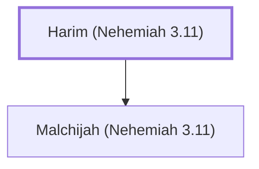

# Harim (Nehemiah 3.11)

Father of Malchijah, a builder of Jerusalem's wall.

**Original-language names:** חָרִם (H2766)

## When

- **Placed around:** [[connections/timeline/5th century BC|445 BC]] *(Ussher: the median date of the passages naming them)*

## Family

- **Children:** [[connections/people/Malchijah (Nehemiah 3.11)|Malchijah (Nehemiah 3.11)]]

**Family group:** [[connections/genealogy/Family of Harim (Nehemiah 3.11)|Family of Harim (Nehemiah 3.11)]], generation 1

## Appears in

[[connections/chapters/16-nehemiah/Nehemiah 3|Nehemiah 3]]

## Appears in the same verse as

[[connections/people/Hasshub (Nehemiah 3.11)|Hasshub (Nehemiah 3.11)]] · [[connections/people/Malchijah (Nehemiah 3.11)|Malchijah (Nehemiah 3.11)]] · [[connections/people/Pahath-moab (Nehemiah 3.11)|Pahath-moab (Nehemiah 3.11)]] · [[connections/places/Tower of the Ovens|Tower of the Ovens]]
